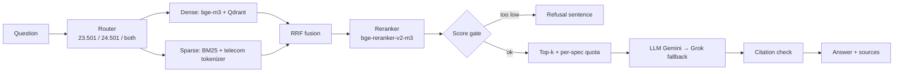
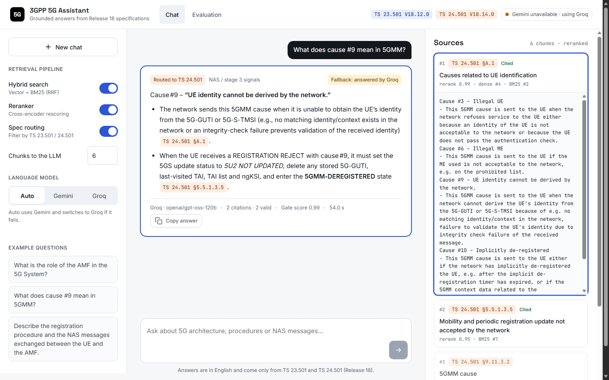
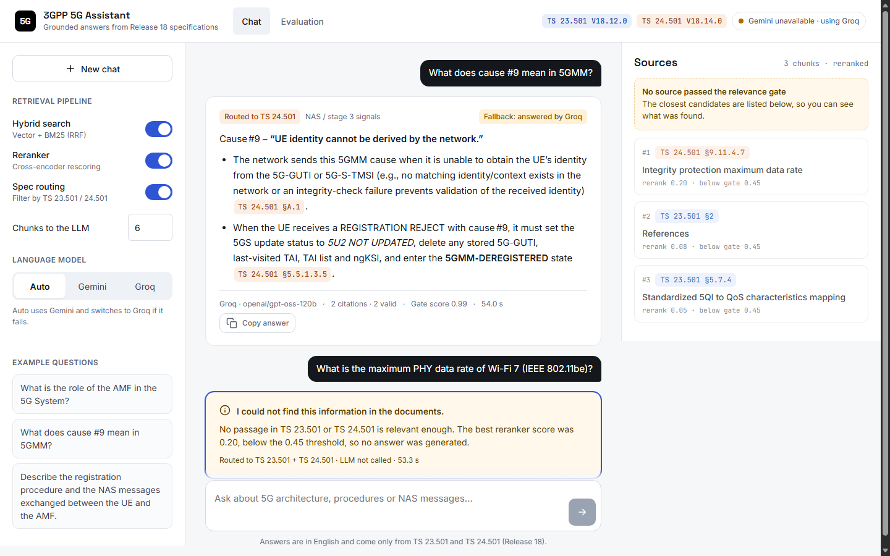
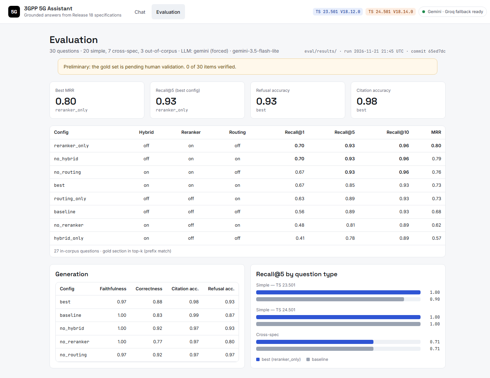
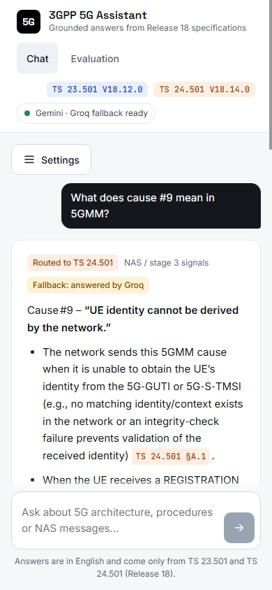

# RAG chatbot for 3GPP 5G specifications

Mini-project "Chatbot RAG pour les spécifications 3GPP 5G" — INSAT, Université de Carthage,
course *Futurs Réseaux Mobiles* (RT5, 2026/2027).

A retrieval-augmented assistant that answers questions **in English** about 5G architecture,
procedures, NAS messages and mechanisms, **using only** two normative 3GPP Release 18
specifications, **citing the spec and section** of every fact (e.g. `[TS 24.501 §A.1]`), and
answering exactly `I could not find this information in the documents.` when the corpus does
not contain the answer.

- **TS 23.501 V18.12.0** — System architecture for the 5G System (Stage 2)
- **TS 24.501 V18.14.0** — NAS protocol for 5GS (Stage 3)

## Architecture



Detailed diagrams and module map: [`docs/architecture.md`](docs/architecture.md).

## Corpus and versions

Pinned in `config.yaml`; provenance (URL, download date, SHA-256, size, docx names) is in
[`data/VERSIONS.md`](data/VERSIONS.md). The archives come from the 3GPP FTP server
(`23501-ic0.zip`, `24501-ie0.zip`; `ic0` = 18.12.0, `ie0` = 18.14.0). Each zip contains one
`.docx`, read in memory. If an archive ever ships only a legacy `.doc`, convert it with
`soffice --headless --convert-to docx` first.

## Requirements

- Python **3.11** (3.12 should also work; 3.14 is not recommended with torch).
- ~8 GB RAM; CPU only is fine (CUDA/MPS used automatically if present).
- ~6 GB disk for the Hugging Face models (bge-m3 2.3 GB and bge-reranker-v2-m3 2.3 GB,
  downloaded automatically on first use; bge-reranker-base, 1.1 GB, only for the fast demo
  profile `configs/fast.yaml`).
- Docker (optional, default vector store) — otherwise Qdrant's local on-disk mode is used.
- API keys: Google Gemini (primary LLM); Groq (free tier, first fallback) and/or xAI Grok
  (second fallback). One key is enough to run.

## Installation

```bash
py -3.11 -m venv .venv            # Linux/macOS: python3.11 -m venv .venv
.venv\Scripts\activate            # Linux/macOS: source .venv/bin/activate
pip install -r requirements.lock  # exact versions used for the reported results
pip install -e ".[dev]" --no-deps # the project itself (or simply: pip install -e ".[dev]")
```

> Windows note: if Smart App Control blocks a freshly released native wheel (we hit this with
> `regex==2026.11.19`, "DLL load failed … Application Control policy"), install the version
> pinned in `requirements.lock` (`regex==2026.9.29`).

## Configuration (`.env`)

```bash
cp .env.example .env
```

Fill in `GEMINI_API_KEY` (from <https://aistudio.google.com/apikey>), `GROQ_API_KEY` (from
<https://console.groq.com/keys>, starts with `gsk_`) and/or `XAI_API_KEY` (from
<https://console.x.ai>, starts with `xai-`; Groq and Grok are different services). Model IDs
are set in `.env` (`GEMINI_MODEL`, `GROQ_MODEL`, `GROK_MODEL`);
list the IDs your keys can use with:

```bash
python -m src.generation.llm --list
```

Everything else (chunk sizes, retrieval depths, thresholds, ablation flags) is in
`config.yaml`. Any value can also be overridden with an environment variable such as
`RAG_RETRIEVAL__USE_HYBRID=false`.

## Usage

```bash
python scripts/download_corpus.py             # 1. corpus → data/raw/ + data/VERSIONS.md
docker compose up -d qdrant                   # 2. vector DB (Docker, default)
python -m src.index.build_index --rebuild     # 3. parse → chunk → embed → Qdrant + BM25
uvicorn app.server:app --host 127.0.0.1 --port 8000   # 4. open http://127.0.0.1:8000  (or: make app)
```

- **Without Docker**: set `qdrant.url: ""` in `config.yaml` (local on-disk mode in
  `data/index/qdrant`), then run step 3. Local mode allows a single process at a time, so do
  not run the app and an evaluation simultaneously in that mode.
- **Build time on CPU** (Intel laptop, 16 threads): parsing + chunking ≈ 30 s, BM25 ≈ 20 s,
  bge-m3 embeddings of the 3,597 chunks ≈ 1 h 30 min (one-off: cached in
  `data/index/emb_bge-m3_<hash>.npy` and reused by later builds).
- Parsing only: `python -m src.ingest.chunker` writes `data/processed/chunks.jsonl` and
  `data/processed/parse_report.md` (statistics, acceptance and spot checks).

- **Demo speed on CPU**: the reranker makes an answer take ≈ 48 s; turn the *Reranker*
  toggle off in the sidebar for ≈ 2 s answers.

`make` shortcuts for all commands are in the `Makefile`.

### Web app

FastAPI serves the API (`/api/health`, `/api/ask`, `/api/examples`, `/api/eval`) and the
static frontend from `app/web/` (plain HTML/CSS/JS, no build step; specification in
[`UI_SPEC.md`](UI_SPEC.md)). The pipeline and models load once at startup (warm-up ≈ 30 s on
CPU); if the index or Qdrant is missing the page shows the command that fixes it.

**Fast demo profile:** `RAG_CONFIG=configs/fast.yaml uvicorn app.server:app --port 8000`
(`make app-fast`) swaps in `bge-reranker-base`. Use it for a live demo on a CPU laptop
when answers must come back quickly and the questions are in English; keep the default
(`bge-reranker-v2-m3`) for the best answer quality and for French questions.

- Chat with citation chips: clicking one opens and highlights the source in the right panel.
- Sidebar: hybrid / reranker / routing switches, chunks to the LLM, language model
  (Auto = Gemini → Groq → Grok, skipping any provider without a key), example questions.
- Refusals show whether the relevance gate refused (with the score and threshold) or the
  LLM did; a fallback answer is badged "Fallback: answered by Groq".
- Evaluation page with the ablation tables read from `eval/results/`.

| Chat | Refusal | Evaluation | Phone (390 px) |
|---|---|---|---|
|  |  |  |  |

## Evaluation

```bash
python -m eval.make_testset_review            # eval/testset_review.md (human validation sheet)
python -m eval.run_retrieval_eval --all-ablations
python -m eval.run_generation_eval --provider gemini --configs best,baseline,no_hybrid,no_reranker,no_routing
python -m eval.make_report                    # eval/results/REPORT.md + figures/
python -m eval.measure_latency                # real CPU latency (no reranker cache)
pytest -q && ruff check . && ruff format --check .
```

LLM outputs and judgements are cached per item in `eval/results/raw/` (git-ignored), so the
generation evaluation resumes where it stopped after a rate limit.

<!-- RESULTS:START -->
## Results (preliminary — gold set pending human validation)

Full report: [`eval/results/REPORT.md`](eval/results/REPORT.md) (tables, charts, per-type
breakdown, router before/after, gate calibration, reranker benchmark, cross-judging,
false-refusal breakdown, statistical caution, failure analysis). Bonuses:
[`eval/results/BONUS.md`](eval/results/BONUS.md).

**Retrieval** — 27 in-corpus questions, top-10 ranking after fusion / reranking; a hit is the
gold clause or one of its sub-clauses. Current defaults: router v2, soft routing (weight 1.5),
BM25 weight 0.5 in RRF, `bge-reranker-v2-m3`, 15 fused candidates, 512 tokens.

| Config | Hybrid | Reranker | Routing | R@1 | R@5 | R@10 | MRR |
|---|---|---|---|---|---|---|---|
| best | ✓ | ✓ | ✓ | 0.741 | 0.889 | 0.926 | 0.807 |
| no_hybrid | ✗ | ✓ | ✓ | 0.741 | 0.889 | 0.926 | 0.807 |
| no_reranker | ✓ | ✗ | ✓ | 0.481 | 0.889 | 0.889 | 0.648 |
| no_routing | ✓ | ✓ | ✗ | 0.667 | 0.889 | 0.926 | 0.770 |
| hybrid_only | ✓ | ✗ | ✗ | 0.481 | 0.852 | 0.889 | 0.627 |
| reranker_only | ✗ | ✓ | ✗ | 0.704 | 0.889 | 0.926 | 0.788 |
| routing_only | ✗ | ✗ | ✓ | 0.630 | 0.889 | 0.926 | 0.730 |
| baseline | ✗ | ✗ | ✗ | 0.556 | 0.889 | 0.926 | 0.677 |

**Generation** — 30 questions per config, answers and LLM judge = `gemini-3.5-flash-lite`.
Faithfulness and correctness are judged **by the same model that wrote the answers**; the
cross-judging table in `eval/results/REPORT.md` (Gemini and Groq answers × Gemini and Groq
judges) is the check for self-preference bias.

| Config | Faithfulness | Correctness | Citation acc. | Gold cited | Refusal F1 | False refusals |
|---|---|---|---|---|---|---|
| **best** | 1.00 | **0.97** | 0.98 | 0.89 | **1.00** | 0 |
| baseline | 1.00 | 0.90 | 0.99 | 0.81 | 0.86 | 1 |
| no_hybrid | 1.00 | 0.95 | 0.98 | 0.89 | 1.00 | 0 |
| no_reranker | 0.97 | 0.90 | 0.94 | 0.85 | 0.86 | 1 |
| no_routing | 1.00 | 0.95 | 0.98 | 0.89 | 1.00 | 0 |

Final defaults: `bge-reranker-v2-m3` (15 candidates, 512 tokens, gate 0.40), soft routing,
BM25 weight 0.5, router v2, prompt v2; all five configs generated and judged in one run
(2026-11-23), no provider fallback. Earlier rounds (previous defaults) are kept in REPORT.md.

What the numbers say:
- **The reranker is the component that matters**: it is the only robust retrieval gain (MRR
  +0.16 with everything else on, 95% paired-bootstrap CI [+0.06, +0.26]), and removing it
  costs the most in generation (correctness 0.97 → 0.90, citation accuracy 0.98 → 0.94, one
  false refusal, one ungrounded answer).
- **Refusals are clean**: all 3 out-of-corpus questions are refused by the score gate before
  the LLM is called (reranker score ≤ 0.13 vs ≥ 0.66 for in-corpus questions); the full
  pipeline has no false refusal. Prompt v2 (answer the covered part, refuse only when no
  source is relevant) together with the v2-m3 reranker took `best` from 6 false refusals to 0.
- **Faithfulness 1.00 and citation accuracy 0.98** in the best config: every factual sentence
  is grounded, and the citation check removes the rare citation to a non-retrieved section.
- **Hybrid and routing**: with the reranker and soft routing on, removing BM25 or routing
  costs one question each (0.97 → 0.95), which is within noise. They are kept because BM25
  catches exact identifiers and routing helps cross-spec questions reach both specs.
- **Simple questions are solved** (R@5 = 1.0 for both specs); **cross-spec questions remain
  the weak spot** (R@5 0.57, the 2 answers not judged fully correct are cross questions).
- **Speed**: about 13 s of CPU reranking per answer with v2-m3; the fast profile
  (`configs/fast.yaml`, `bge-reranker-base`) brings end-to-end latency to about 7.6 s for a
  live demo, at some cost in answer quality.
- With n = 27 in-corpus questions, one question = 0.037 of recall: read small differences as
  noise (see "Statistical caution" in the report).

### Re-running the evaluation after validating the test set

Edit `eval/testset.json` (fix items, set `"verified": true`), then:

```bash
python -m eval.make_testset_review                       # regenerate the review sheet
python -m eval.run_retrieval_eval --all-ablations        # ~20 min on CPU; rerank scores cached
# copy reranker_threshold / dense_threshold from eval/results/gate_choice.json into config.yaml
python -m eval.run_generation_eval --provider gemini --configs best,baseline,no_hybrid,no_reranker,no_routing
python -m eval.run_cross_judge --judge gemini            # cross-judge (frozen best answers)
python -m eval.run_cross_judge --judge groq              # waits for Groq's daily token window
python -m eval.measure_latency                           # real latency (warm, no cache)
python -m eval.bench_reranker                            # optional: speed/quality benchmark
python -m eval.make_report && python -m eval.make_bonus_report
```

- Answers are cached per question in `eval/results/raw/gen_<config>_<provider>.jsonl` and are
  regenerated automatically when the settings that produced them changed (config snapshot);
  edited questions keep their id, so delete their lines to force a new answer. Judgements are
  recomputed only where missing.
- The free tiers limit throughput (Gemini flash-lite 500 requests/day ≈ 4 configurations;
  Groq 200k tokens/day): every command resumes where it stopped.
- The cross-judge answer sets are frozen in `eval/results/raw/crossjudge/` (delete them to
  freeze new `best` answers). The Groq answer set was produced with the previous settings:
  `RAG_RETRIEVAL__ROUTER_VERSION=1 RAG_RETRIEVAL__FUSED_TOP_N=30
  RAG_RERANKER__MODEL=BAAI/bge-reranker-v2-m3 RAG_RERANKER__MAX_LENGTH=1024
  RAG_GATE__RERANKER_THRESHOLD=0.45 python -m eval.run_generation_eval --provider groq
  --configs best --no-judge`.
<!-- RESULTS:END -->

## Bonus experiments

Results: [`eval/results/BONUS.md`](eval/results/BONUS.md) (preliminary, same unverified
test set).

| Bonus | How to run | Headline (preliminary) |
|---|---|---|
| French questions → English answers | `python -m eval.run_retrieval_eval --testset eval/testset_fr.json --tag fr --configs best,no_hybrid,no_reranker,baseline` (+ `--translate-bm25 --tag fr_translated`), `python -m eval.run_generation_eval --testset eval/testset_fr.json --tag fr --configs best` | bge-m3 + reranker as good on French as on English (MRR 0.785 vs 0.734 for `best`); answers stay in English |
| Embedding comparison | `python -m src.index.build_index --skip-parse --embedding-model BAAI/bge-small-en-v1.5`, then `python -m eval.run_retrieval_eval --embedding-model BAAI/bge-small-en-v1.5 --tag bge-small --configs baseline,no_hybrid,best` | bge-small: 5 min indexing vs 74 min; weaker alone (MRR 0.616 vs 0.677), on par once reranked |
| LLM comparison (API vs local) | `ollama create llama3.2-3b-8k` (num_ctx 8192), `OLLAMA_MODEL=llama3.2-3b-8k python -m eval.run_generation_eval --provider ollama --configs best` | Llama 3.2 3B: correctness 0.77, citation accuracy 0.71 vs Gemini 0.88 / 0.98 |
| + TS 23.502 | `RAG_CONFIG=configs/rel18_3specs.yaml python scripts/download_corpus.py`, `... python -m src.index.build_index --rebuild`, `... python -m eval.run_retrieval_eval --tag 3specs --configs no_routing,reranker_only` | 23.502 takes ~1.7/6 sources on cross questions and slightly lowers recall of the original gold clauses |
| Rel-17 vs Rel-18 | `RAG_CONFIG=configs/rel17.yaml ...` (same commands, `--tag rel17`) | retrieval equivalent (MRR 0.731 vs 0.734) |

Corpus variants are selected with `RAG_CONFIG` and get their own `data/processed/<variant>/`,
`data/index/<variant>/` and Qdrant collection, so the main index is never touched.

## Technical choices

| Choice | Why |
|---|---|
| Structural chunking (one chunk per clause, ≤ 800 tokens, tables never split mid-row) | citations must point to an exact clause; tables (timers, cause values, IE lists, 5QI) carry many answers |
| Contextual header in every chunk (`[TS 24.501 §5.5.1.2.4 Title \| parents…]`) | both BM25 and the embedder see the spec, clause number and parent titles |
| bge-m3 dense embeddings | strong multilingual retriever (Chen et al. 2024), 8k context, enables French questions |
| BM25 with a telecom tokenizer | exact identifiers (`T3510`, `cause #9`, `S-NSSAI`, `5.5.1.2.4`) are where dense models are weakest |
| Reciprocal Rank Fusion (k = 60), BM25 weight 0.5 | rank-based fusion of heterogeneous scores; the BM25 list counts half (MRR 0.807 vs 0.750 at weight 1.0) so keyword-only matches do not crowd the reranker's 15 candidates |
| Cross-encoder reranker + score gate | `bge-reranker-v2-m3` (multilingual) reorders the 15 best fused candidates (512 tokens each): the CPU benchmark (`eval/results/reranker_bench.csv`) cut reranking from 43.8 s (30 candidates, 1,024 tokens) to 12.8 s per answer with no MRR loss. `bge-reranker-base` (3.9 s) is kept as the fast demo profile `configs/fast.yaml`; it was the default for one round but lost answer correctness (0.88 → 0.80), so the default went back to v2-m3. Its calibrated score decides when to refuse *before* calling the LLM |
| Rule-based router (v2), soft routing | the two specs are complementary (Stage 2 vs Stage 3). Soft routing searches both specs and boosts the routed spec's chunks 1.5× in RRF, so a wrong route no longer removes the other spec (MRR 0.807 vs 0.770 for hard filtering). v2 sends a question to both specs when it mixes architecture and NAS signals or asks about a procedure and its messages; tuned only on `tests/test_router.py`; `retrieval.router_version: 1` restores the original rules |
| Gemini primary, Groq then Grok fallbacks | free-tier rate limits and outages; providers without a key are skipped; a 429 waits for the API's Retry-After before retrying or falling back; every answer records the provider/model actually used. Default model `gemini-3.5-flash-lite` (flash models: 20 requests/day on the free tier); `llm.max_tokens` = 8192 because Gemini 3.x thinking tokens share the output budget |
| Calibrated score gate | reranker threshold 0.40 (bge-reranker-v2-m3 @512: out-of-corpus max 0.13, in-corpus min 0.66; 0.15 for bge-reranker-base in `configs/fast.yaml`) / dense threshold 0.55 chosen by `eval.run_retrieval_eval` (max refusal rate with zero false refusals), stored in `config.yaml` |
| Citation check | removes citations to sections that were not retrieved, flags ungrounded answers |
| No LangChain / LlamaIndex | every component is a small swappable module, which is what the ablations need |

## Limitations

<!-- LIMITATIONS:START -->
- The test set is small (30 questions, only 3 out-of-corpus) and drafted by the author; all
  numbers are preliminary until a human validates it (`eval/testset_review.md`). The gate
  threshold in particular is calibrated on 3 negative questions.
- Cross-spec questions: the rule-based router routes most of them to one spec, and the
  per-spec quota cannot help when the route is a single spec.
- Faithfulness / correctness come from an LLM judge with a fixed rubric (not RAGAS) using the
  same model as the generator, so they are indicative.
- Free-tier LLM quotas: Gemini flash models allow 20 requests/day per model, so the reported
  runs use `gemini-3.5-flash-lite`. The Grok fallback was not exercised (invalid key during
  this work).
- CPU only: the cross-encoder reranker takes ≈ 45 s per question; bge-m3 indexing takes
  ≈ 75 min once.
- Figures are only represented by their captions; 12 table rows larger than 800 tokens are
  kept whole (never split mid-row) and truncated to 1,024 tokens by the embedder.
- TS 23.501 describes procedures only at Stage 2 level; detailed call flows (TS 23.502) are
  not in the corpus.
<!-- LIMITATIONS:END -->

## Perspectives

- Add TS 23.502 (procedures): the registration / PDU session call flows live there.
- Multi-release comparison (Rel-17 vs Rel-18).
- French questions → English answers with bge-m3 (and query translation for BM25).
- Better routing for cross-spec questions (route procedure questions to both specs, or a
  learned / LLM router), query decomposition into one sub-question per spec.
- Retrieve dense candidates and BM25 candidates for the reranker separately (instead of a
  fused top-30) so that BM25 stops displacing good dense candidates.
- GPU or a smaller reranker for interactive latency; figure understanding.

## Project structure

```
config.yaml · .env.example · docker-compose.yml · Makefile · requirements.lock
data/        VERSIONS.md (committed) · raw/ processed/ index/ (generated)
scripts/     download_corpus.py · inspect_docx_styles.py · sample_chunks.py
src/         config.py · schemas.py · pipeline.py
  ingest/    parse_docx.py · chunker.py · tokenizer.py
  index/     embed.py · qdrant_store.py · bm25_store.py · build_index.py
  retrieval/ router.py · hybrid.py · reranker.py
  generation/ prompts.py · llm.py · citation_check.py
app/         server.py (FastAPI) · api_models.py · web/ (HTML, CSS, JS, vendored marked + DOMPurify)
eval/        testset.json · testset_review.md · metrics.py · configs.py ·
             run_retrieval_eval.py · run_generation_eval.py · make_report.py · results/
docs/        architecture.md · presentation_outline.md
tests/       unit tests (offline: fixture chunks, fake LLM)
CLAUDE.md · UI_SPEC.md · PROGRESS.md   process documentation (see below)
```

## Development process

The project was developed with an AI coding assistant. `CLAUDE.md` (project specification
and rules), `UI_SPEC.md` (web interface specification) and `PROGRESS.md` (build log,
decisions and open items) are kept in the repository as process documentation.

## References

- P. Lewis et al., *Retrieval-Augmented Generation for Knowledge-Intensive NLP Tasks*, 2020,
  arXiv:2005.11401.
- S. Robertson, H. Zaragoza, *The Probabilistic Relevance Framework: BM25 and Beyond*,
  Foundations and Trends in IR, 2009.
- J. Chen et al., *BGE M3-Embedding: Multi-Lingual, Multi-Functionality, Multi-Granularity
  Text Embeddings Through Self-Knowledge Distillation*, 2024, arXiv:2402.03216.
- S. Es et al., *RAGAS: Automated Evaluation of Retrieval Augmented Generation*, 2023,
  arXiv:2309.15217.
- 3GPP TS 23.501 V18.12.0 and TS 24.501 V18.14.0.
