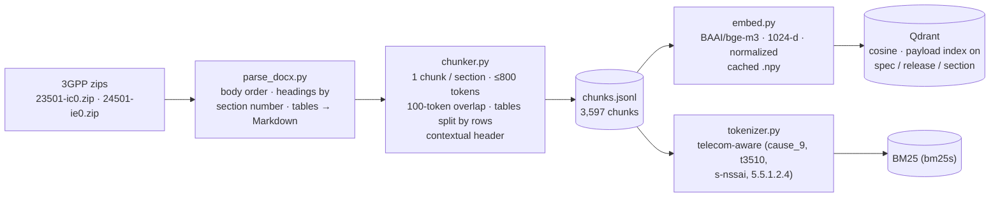
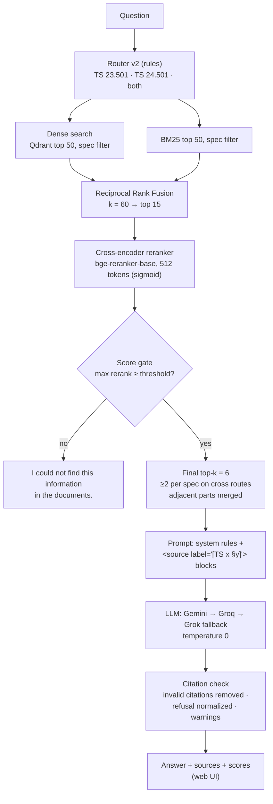

# Architecture

## Offline: ingestion and indexing

## Online: question answering

## Modules

| Layer | Module | Responsibility |
|---|---|---|
| Config | `src/config.py` | `config.yaml` → typed `Settings`; nested overrides for ablations |
| Ingestion | `src/ingest/parse_docx.py` | ordered paragraphs/tables, headings, annexes, Markdown tables |
| | `src/ingest/chunker.py` | structural chunks, acceptance checks, `parse_report.md` |
| | `src/ingest/tokenizer.py` | BM25 tokenizer shared by indexing and querying |
| Indexing | `src/index/embed.py`, `qdrant_store.py`, `bm25_store.py`, `build_index.py` | dense + sparse indexes |
| Retrieval | `src/retrieval/router.py`, `hybrid.py`, `reranker.py` | routing, RRF, quotas, part merging, reranking |
| Generation | `src/generation/prompts.py`, `llm.py`, `citation_check.py` | prompt, LLM fallback, citation validation |
| Orchestration | `src/pipeline.py` | `RAGPipeline.retrieve()` / `.answer()`, score gate, timings |
| UI | `app/server.py`, `app/web/` | FastAPI API + static web frontend (UI_SPEC.md): chat, toggles, sources panel, evaluation page |
| Evaluation | `eval/` | test set, retrieval and generation evaluations, report |

Every component is injectable in `RAGPipeline` (dense searcher, BM25, embedder, reranker,
LLM), which is how the unit tests run offline and how the evaluation reuses one loaded index
across all ablation configurations.
