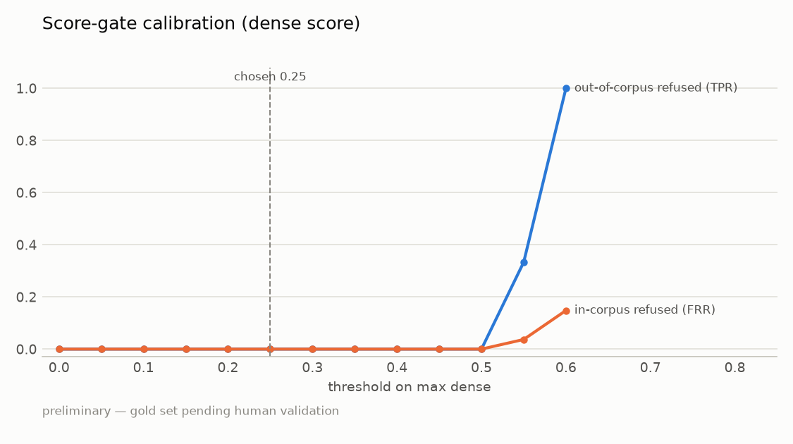

# Evaluation report

> **Status: preliminary — gold set pending human validation.** 30/30 test items are not yet validated by a human (`eval/testset_review.md`). All tables below are preliminary.

## Setup

- Corpus: TS 23.501 V18.12.0 (Rel-18), TS 24.501 V18.14.0 (Rel-18) — see `data/VERSIONS.md`
- Embeddings: `BAAI/bge-m3` · reranker: `BAAI/bge-reranker-base` · vector DB: Qdrant (cosine) · BM25: bm25s + telecom tokenizer · RRF k = 60
- Retrieval: dense top 50, BM25 top 50, fused top 15, final top-k 6, ≥2 chunks per spec for cross routes
- Test set: 30 questions (20 simple, 7 cross, 3 out-of-corpus); retrieval metrics on the 27 in-corpus questions, top-10 ranking after fusion/rerank; a hit is the gold section or one of its sub-clauses, same spec
- Retrieval run: 2026-11-22 03:41 UTC, commit `c1d4a56`

Configurations: `best` = hybrid on, reranker on, routing on; `no_hybrid` = hybrid off, reranker on, routing on; `no_reranker` = hybrid on, reranker off, routing on; `no_routing` = hybrid on, reranker on, routing off; `hybrid_only` = hybrid on, reranker off, routing off; `reranker_only` = hybrid off, reranker on, routing off; `routing_only` = hybrid off, reranker off, routing on; `baseline` = hybrid off, reranker off, routing off

## Retrieval

### Retrieval ablation — all in-corpus questions (n=27) — *preliminary — gold set pending human validation*

| Config | Hybrid | Reranker | Routing | R@1 | R@3 | R@5 | R@10 | MRR |
|---|---|---|---|---|---|---|---|---|
| best | ✓ | ✓ | ✓ | 0.704 | 0.778 | 0.815 | 0.852 | 0.747 |
| no_hybrid | ✗ | ✓ | ✓ | 0.778 | 0.852 | 0.852 | 0.926 | 0.817 |
| no_reranker | ✓ | ✗ | ✓ | 0.481 | 0.704 | 0.815 | 0.889 | 0.622 |
| no_routing | ✓ | ✓ | ✗ | 0.593 | 0.741 | 0.852 | 0.889 | 0.691 |
| hybrid_only | ✓ | ✗ | ✗ | 0.407 | 0.667 | 0.778 | 0.889 | 0.574 |
| reranker_only | ✗ | ✓ | ✗ | 0.704 | 0.852 | 0.889 | 0.926 | 0.785 |
| routing_only | ✗ | ✗ | ✓ | 0.630 | 0.852 | 0.889 | 0.926 | 0.730 |
| baseline | ✗ | ✗ | ✗ | 0.556 | 0.815 | 0.889 | 0.926 | 0.677 |

### Per question type (R@5 / MRR) — *preliminary — gold set pending human validation*

| Config | simple-23 R@5 | simple-24 R@5 | cross R@5 | simple-23 MRR | simple-24 MRR | cross MRR | cross both-spec R@5 | cross both-spec R@10 |
|---|---|---|---|---|---|---|---|---|
| best | 0.900 | 1.000 | 0.429 | 0.900 | 0.803 | 0.446 | 0.000 | 0.000 |
| no_hybrid | 1.000 | 1.000 | 0.429 | 1.000 | 0.883 | 0.462 | 0.000 | 0.000 |
| no_reranker | 0.800 | 0.900 | 0.714 | 0.717 | 0.623 | 0.486 | 0.000 | 0.000 |
| no_routing | 0.800 | 1.000 | 0.714 | 0.750 | 0.803 | 0.446 | 0.143 | 0.143 |
| hybrid_only | 0.800 | 0.900 | 0.571 | 0.625 | 0.625 | 0.427 | 0.143 | 0.143 |
| reranker_only | 1.000 | 1.000 | 0.571 | 0.950 | 0.883 | 0.407 | 0.143 | 0.143 |
| routing_only | 0.900 | 1.000 | 0.714 | 0.796 | 0.792 | 0.548 | 0.000 | 0.000 |
| baseline | 0.900 | 1.000 | 0.714 | 0.679 | 0.792 | 0.512 | 0.143 | 0.286 |

### Router accuracy — *preliminary — gold set pending human validation*

| n | route ⊇ gold specs | exact | exact simple-23 | exact simple-24 | exact cross |
|---|---|---|---|---|---|
| 27 | 0.815 | 0.778 | 1.000 | 0.900 | 0.286 |

### Score-gate calibration — *preliminary — gold set pending human validation*

Rule: max refusal TPR with zero false refusals; ties -> middle threshold. Chosen: reranker_threshold = **0.1**, dense_threshold = **0.25** (recorded in `config.yaml`).

| threshold | refusal TPR (out-of-corpus) | false-refusal rate |
|---|---|---|
| 0.0 | 0.000 | 0.000 |
| 0.05 | 0.667 | 0.000 |
| 0.1 | 0.667 | 0.000 |
| 0.15 | 0.667 | 0.037 |
| 0.2 | 0.667 | 0.037 |
| 0.25 | 0.667 | 0.037 |
| 0.3 | 1.000 | 0.074 |
| 0.35 | 1.000 | 0.074 |
| 0.4 | 1.000 | 0.074 |
| 0.45 | 1.000 | 0.074 |
| 0.5 | 1.000 | 0.074 |
| 0.55 | 1.000 | 0.074 |
| 0.6 | 1.000 | 0.074 |

| threshold | refusal TPR (out-of-corpus) | false-refusal rate |
|---|---|---|
| 0.0 | 0.000 | 0.000 |
| 0.05 | 0.000 | 0.000 |
| 0.1 | 0.000 | 0.000 |
| 0.15 | 0.000 | 0.000 |
| 0.2 | 0.000 | 0.000 |
| 0.25 | 0.000 | 0.000 |
| 0.3 | 0.000 | 0.000 |
| 0.35 | 0.000 | 0.000 |
| 0.4 | 0.000 | 0.000 |
| 0.45 | 0.000 | 0.000 |
| 0.5 | 0.000 | 0.000 |
| 0.55 | 0.333 | 0.037 |
| 0.6 | 1.000 | 0.148 |

## Generation

### Generation — current defaults — provider `gemini` (gemini-3.5-flash-lite) — *preliminary — gold set pending human validation*

> Run stopped early (quota): judge no_hybrid/o-02: All LLM providers failed:. Rows with n < n_expected are partial; re-run the same command to resume.

| Config | n | Faithfulness | Correctness | Citation acc. | Citation acc. (loose) | Gold cited | Not grounded | Refusal P | Refusal R | Refusal F1 | False refusals | Latency mean (s) | p95 (s) | Fallback |
|---|---|---|---|---|---|---|---|---|---|---|---|---|---|---|
| best | 30/30 | 1.00 | 0.80 | 0.97 | 0.97 | 0.74 | 0.00 | 0.33 | 1.00 | 0.50 | 6 | 4.0 | 6.7 | 0.00 |
| baseline | 30/30 | 1.00 | 0.82 | 0.99 | 0.99 | 0.78 | 0.00 | 0.38 | 1.00 | 0.55 | 5 | 4.0 | 8.1 | 0.00 |
| no_hybrid | 30/30 | 1.00 | 0.83 | 1.00 | 1.00 | 0.74 | 0.00 | 0.43 | 1.00 | 0.60 | 4 | 3.1 | 6.0 | 0.00 |

Faithfulness and correctness: LLM judge with a fixed 0 / 0.5 / 1 rubric (`eval/metrics.py`), judge = Gemini — **the same model that generated the answers**, so these two columns may carry self-preference bias; see the cross-judging section for the check. Citation accuracy = valid citations / all citations (strict: exact section among the sources; loose: also ancestors). Gold cited = answer cites ≥1 gold section.

Current defaults: router v2, bge-reranker-base, 15 candidates, 512 tokens, gate 0.10. `no_reranker` and `no_routing` are pending (Gemini free-tier daily quota); the complete 5-configuration run with the previous defaults is below. Compared with that run, `best` correctness went 0.88 → 0.80: five questions were refused by the LLM because a key chunk was no longer among the 6 sources (e.g. s23-01: §6.2.1 AMF; s23-07: the 5QI-1 row of Table 5.7.4-1), two improved. The paired change is −0.08, 95% CI [−0.23, +0.05] (not established on 30 questions), but the mechanism is concrete: the faster reranker trades some answer quality for 6× lower latency.

### Generation — previous defaults (router v1, bge-reranker-v2-m3, 30 candidates, 1024 tokens) — provider `gemini` (gemini-3.5-flash-lite) — *preliminary — gold set pending human validation*

> Run stopped early (quota): judge no_hybrid/o-02: All LLM providers failed:. Rows with n < n_expected are partial; re-run the same command to resume.

| Config | n | Faithfulness | Correctness | Citation acc. | Citation acc. (loose) | Gold cited | Not grounded | Refusal P | Refusal R | Refusal F1 | False refusals | Latency mean (s) | p95 (s) | Fallback |
|---|---|---|---|---|---|---|---|---|---|---|---|---|---|---|
| best | 30/30 | 0.97 | 0.88 | 0.98 | 0.98 | 0.81 | 0.00 | 0.60 | 1.00 | 0.75 | 2 | 2.1 | 3.8 | 0.00 |
| baseline | 30/30 | 1.00 | 0.83 | 0.99 | 0.99 | 0.78 | 0.00 | 0.43 | 1.00 | 0.60 | 4 | 1.9 | 3.3 | 0.00 |
| no_hybrid | 30/30 | 1.00 | 0.92 | 0.97 | 0.97 | 0.93 | 0.00 | 0.60 | 1.00 | 0.75 | 2 | 2.0 | 4.0 | 0.00 |
| no_reranker | 30/30 | 1.00 | 0.77 | 0.97 | 0.97 | 0.67 | 0.00 | 0.33 | 1.00 | 0.50 | 6 | 1.7 | 2.7 | 0.00 |
| no_routing | 30/30 | 0.97 | 0.92 | 0.97 | 0.97 | 0.89 | 0.00 | 0.75 | 1.00 | 0.86 | 1 | 1.8 | 3.4 | 0.00 |

Faithfulness and correctness: LLM judge with a fixed 0 / 0.5 / 1 rubric (`eval/metrics.py`), judge = Gemini — **the same model that generated the answers**, so these two columns may carry self-preference bias; see the cross-judging section for the check. Citation accuracy = valid citations / all citations (strict: exact section among the sources; loose: also ancestors). Gold cited = answer cites ≥1 gold section.

### Real end-to-end latency (CPU laptop, no reranker cache)

| Config | n | LLM | total mean (s) | total max (s) | dense (s) | rerank (s) | LLM (s) |
|---|---|---|---|---|---|---|---|
| best | 5 | gemini-3.1-flash-lite | 7.6 | 8.5 | 0.15 | 4.14 | 3.28 |
| no_reranker | 5 | gemini-3.1-flash-lite | 3.0 | 4.2 | 0.15 | 0.0 | 2.83 |

The latency columns of the generation table above reuse cached reranker scores (`eval/results/raw/rerank_cache.json`) and therefore exclude the cross-encoder compute; this table (`python -m eval.measure_latency`) shows what an app user waits for on CPU.

## Cross-judging: self-preference check

The main generation tables are judged by the same model that wrote the answers (gemini-3.5-flash-lite judges gemini-3.5-flash-lite). As a check, the `best` answers of two models are each judged by both judges, on frozen answer sets (`eval/results/raw/crossjudge/`) with the same rubric. Both answer sets were produced with router v1 (the router at the time of the original run).

**Faithfulness**

| Answers \ Judge | gemini judge (gemini-3.5-flash-lite) | groq judge (openai/gpt-oss-120b) |
|---|---|---|
| gemini answers (gemini-3.5-flash-lite) | 1.00 (n=9) | 1.00 (n=9) |
| groq answers (openai/gpt-oss-120b) | 1.00 (n=9) | 0.94 (n=9) |

**Correctness**

| Answers \ Judge | gemini judge (gemini-3.5-flash-lite) | groq judge (openai/gpt-oss-120b) |
|---|---|---|
| gemini answers (gemini-3.5-flash-lite) | 1.00 (n=9) | 0.94 (n=9) |
| groq answers (openai/gpt-oss-120b) | 1.00 (n=9) | 0.94 (n=9) |

Metrics that need no judge (same frozen answers):

| Answers | Citation acc. | Gold cited | Refusal P | Refusal R | Refusal F1 | False refusals |
|---|---|---|---|---|---|---|
| gemini (gemini-3.5-flash-lite) | 0.98 | 0.81 | 0.60 | 1.00 | 0.75 | 2 |
| groq (openai/gpt-oss-120b) | 0.98 | 0.67 | 0.00 | 0.00 | 0.00 | 1 |

**Self-preference.** faithfulness: on average a judge scores its own model's answers -0.03 higher than the other judge does (Gemini judge on Gemini answers +0.00, Groq judge on Groq answers -0.06); correctness: on average a judge scores its own model's answers +0.00 higher than the other judge does (Gemini judge on Gemini answers +0.06, Groq judge on Groq answers -0.06). A positive value is a self-preference bias of that size; with 30 questions, a few hundredths is one or two answers, so only a gap that both judges agree on (same ranking of the two answer sets) should be trusted.

## False refusals: gate or LLM?

15 in-corpus questions were refused across the reported generation configurations (current defaults): **0 by the score gate**, **15 by the LLM** after it saw the sources. A gate refusal means retrieval found nothing above the threshold; an LLM refusal means the model judged the retrieved sources insufficient (typically one half of a cross-spec question was missing).

| Config | Question | Type | Refused by | Gate score |
|---|---|---|---|---|
| `best` | `s23-01` | simple | LLM (gemini-3.5-flash-lite) | 0.968 |
| `best` | `s23-07` | simple | LLM (gemini-3.5-flash-lite) | 0.991 |
| `best` | `x-01` | cross | LLM (gemini-3.5-flash-lite) | 0.999 |
| `best` | `x-02` | cross | LLM (gemini-3.5-flash-lite) | 0.998 |
| `best` | `x-03` | cross | LLM (gemini-3.5-flash-lite) | 0.992 |
| `best` | `x-04` | cross | LLM (gemini-3.5-flash-lite) | 0.960 |
| `no_hybrid` | `s23-07` | simple | LLM (gemini-3.5-flash-lite) | 0.991 |
| `no_hybrid` | `x-03` | cross | LLM (gemini-3.5-flash-lite) | 0.992 |
| `no_hybrid` | `x-04` | cross | LLM (gemini-3.5-flash-lite) | 0.960 |
| `no_hybrid` | `x-05` | cross | LLM (gemini-3.5-flash-lite) | 0.995 |
| `baseline` | `s23-01` | simple | LLM (gemini-3.5-flash-lite) | 0.664 |
| `baseline` | `x-01` | cross | LLM (gemini-3.5-flash-lite) | 0.766 |
| `baseline` | `x-02` | cross | LLM (gemini-3.5-flash-lite) | 0.741 |
| `baseline` | `x-03` | cross | LLM (gemini-3.5-flash-lite) | 0.748 |
| `baseline` | `x-05` | cross | LLM (gemini-3.5-flash-lite) | 0.730 |

## Reranker speed / quality benchmark (CPU)

MRR / recall of the `best` configuration on the in-corpus questions for each number of fused candidates sent to the reranker (`retrieval.fused_top_n`) and truncation length (`reranker.max_length`). Latency = reranking time per answer, measured without cache on a fixed sample of questions; retrieval = reranking + routing / dense / BM25. The LLM adds ≈ 2 s (see the latency table).

| Reranker | fused_top_n | max_length | MRR | R@5 | R@10 | rerank s/answer | max s | retrieval s/answer |
|---|---|---|---|---|---|---|---|---|
| bge-reranker-v2-m3 | 15 | 512 | 0.754 | 0.852 | 0.852 | 12.8 | 13.0 | 13.0 |
| bge-reranker-v2-m3 | 20 | 512 | 0.744 | 0.852 | 0.926 | 16.6 | 17.5 | 16.8 |
| bge-reranker-v2-m3 | 30 | 512 | 0.732 | 0.852 | 0.889 | 26.0 | 26.6 | 26.2 |
| bge-reranker-v2-m3 | 15 | 1024 | 0.753 | 0.852 | 0.889 | 23.4 | 24.5 | 23.6 |
| bge-reranker-v2-m3 | 20 | 1024 | 0.756 | 0.852 | 0.926 | 27.9 | 30.6 | 28.0 |
| bge-reranker-v2-m3 | 30 | 1024 | 0.734 | 0.852 | 0.926 | 43.8 | 46.1 | 43.9 |
| bge-reranker-base | 15 | 512 | 0.747 | 0.815 | 0.852 | 3.9 | 4.0 | 4.0 |
| bge-reranker-base | 20 | 512 | 0.746 | 0.852 | 0.889 | 4.9 | 5.3 | 5.0 |
| bge-reranker-base | 30 | 512 | 0.727 | 0.852 | 0.852 | 7.6 | 8.1 | 7.8 |

**Chosen default:** BAAI/bge-reranker-base with fused_top_n=15, max_length=512: MRR 0.747 vs 0.734 for the previous default (bge-reranker-v2-m3, 30, 1024); reranking 3.9 s instead of 43.8 s per answer on this CPU. Rule: fastest setting whose MRR stays within 0.02 of the previous default. Trade-offs: recall@5 0.815 vs 0.852 (one question); bge-reranker-base is English/Chinese, not multilingual (the French bonus used bge-reranker-v2-m3).

## Router: before / after

Router v2 adds three general rules (architecture AND NAS signals → both specs; "procedure … messages" phrasing → both specs; more verbs that ask what a network function does). It was tuned **only** on `tests/test_router.py` (12 new cross-spec questions written independently of the test set, plus single-spec guards); the evaluation set was not used for tuning. Both columns use the same retrieval settings (current reranker defaults); only `retrieval.router_version` differs.

| Router accuracy (config best) | v1 | v2 |
|---|---|---|
| route ⊇ gold specs | 0.778 | 0.815 |
| exact route | 0.741 | 0.778 |
| exact, simple 23.501 | 1.000 | 1.000 |
| exact, simple 24.501 | 0.900 | 0.900 |
| exact, cross-spec | 0.143 | 0.286 |

| Config | Metric | v1 | v2 |
|---|---|---|---|
| `best` | cross recall@5 | 0.429 | 0.429 |
| `best` | cross both_recall@5 | 0.000 | 0.000 |
| `best` | cross mrr | 0.446 | 0.446 |
| `best` | all recall@5 | 0.815 | 0.815 |
| `best` | all mrr | 0.747 | 0.747 |
| `routing_only` | cross recall@5 | 0.714 | 0.714 |
| `routing_only` | cross both_recall@5 | 0.000 | 0.000 |
| `routing_only` | cross mrr | 0.548 | 0.548 |
| `routing_only` | all recall@5 | 0.889 | 0.889 |
| `routing_only` | all mrr | 0.730 | 0.730 |

## Statistical caution

Only **n = 27** in-corpus questions are scored, so one question moves recall@k by **0.037** and a difference of a few hundredths is a single question. The table gives the paired difference of per-question scores between two configurations that differ by one component, with a 95% paired-bootstrap interval (10,000 resamples, seed 42). A difference is called *robust* only when the interval excludes 0; otherwise it is within noise for this test set.

| Component | Comparison | Metric | Δ | 95% CI | Verdict |
|---|---|---|---|---|---|
| reranker (all else on) | `best` − `no_reranker` | mrr | +0.125 | [+0.021, +0.243] | robust |
| reranker (all else on) | `best` − `no_reranker` | recall@5 | +0.000 | [-0.148, +0.148] | within noise |
| reranker (dense only) | `reranker_only` − `baseline` | mrr | +0.107 | [-0.015, +0.236] | within noise |
| reranker (dense only) | `reranker_only` − `baseline` | recall@5 | +0.000 | [-0.111, +0.111] | within noise |
| BM25 fusion (with reranker) | `best` − `no_hybrid` | mrr | -0.071 | [-0.165, -0.004] | robust |
| BM25 fusion (with reranker) | `best` − `no_hybrid` | recall@5 | -0.037 | [-0.111, +0.000] | within noise |
| BM25 fusion (no reranker) | `hybrid_only` − `baseline` | mrr | -0.104 | [-0.244, +0.038] | within noise |
| BM25 fusion (no reranker) | `hybrid_only` − `baseline` | recall@5 | -0.111 | [-0.259, +0.000] | within noise |
| routing (with reranker) | `best` − `no_routing` | mrr | +0.056 | [-0.037, +0.167] | within noise |
| routing (with reranker) | `best` − `no_routing` | recall@5 | -0.037 | [-0.148, +0.074] | within noise |
| routing (no reranker) | `routing_only` − `baseline` | mrr | +0.052 | [+0.000, +0.120] | within noise |
| routing (no reranker) | `routing_only` − `baseline` | recall@5 | +0.000 | [+0.000, +0.000] | within noise |

Robust effects on this set: BM25 fusion (with reranker), reranker (all else on). Every other difference in the ablation tables, including hybrid vs no-hybrid, should be read as *not established* until a larger, validated test set confirms it.

## Qualitative examples (config `best`)

### Simple question — `s23-02`

**Q:** Which functionalities does the SMF provide?

**Answer:**

> The Session Management function (SMF) includes the following functionalities:
> 
> - Session Management e.g. Session Establishment, modify and release, including tunnel maintain between UPF and AN node [TS 23.501 §6.2.2].
> - UE IP address allocation & management (including optional Authorization). The UE IP address may be received from a UPF or from an external data network [TS 23.501 §6.2.2].
> - DHCPv4 (server and client) and DHCPv6 (server and client) functions [TS 23.501 §6.2.2].
> - Functionality to respond to Address Resolution Protocol (ARP) requests and / or IPv6 Neighbour Solicitation requests based on local cache information for the Ethernet PDUs. The SMF responds to the ARP and / or the IPv6 Neighbour Solicitation Request by providing the MAC address corresponding to the IP address sent in the request [TS 23.501 §6.2.2].
> - Selection and control of UP function, including controlling the UPF to proxy ARP or IPv6 Neighbour Discovery, or to forward all ARP/IPv6 Neighbour Solicitation traffic to the SMF, for Ethernet PDU Sessions [TS 23.501 §6.2.2].
> - Configures traffic steering at UPF to route traffic to proper destination [TS 23.501 §6.2.2].
> - 5G VN group management, e.g. maintain the topology of the involved PSA UPFs, establish and release the N19 tunnels between PSA UPFs, configure traffic forwarding at UPF to apply local switching, N6-based forwarding or N19-based forwarding, manage traffic forwarding in the case that a SMF Set or multiple SMF Sets are serving a 5G VN [TS 23.501 §6.2.2].
> - Termination of interfaces towards Policy control functions [TS 23.501 §6.2.2].
> - Lawful intercept (for SM events and interface to LI System) [TS 23.501 §6.2.2].
> - Support for charging [TS 23.501 §6.2.2].
> - Control and coordination of charging data collection at UPF [TS 23.501 §6.2.2].
> - Termination of SM parts of NAS messages [TS 23.501 §6.2.2].
> - Downlink Data Notification [TS 23.501 §6.2.2].
> - Initiator of AN specific SM information, sent via AMF over N2 to AN [TS 23.501 §6.2.2].
> - Determine SSC mode of a session [TS 23.501 §6.2.2].
> - Support for Control Plane CIoT 5GS Optimisation [TS 23.501 §6.2.2].
> - Support of header compression [TS 23.501 §6.2.2].
> - Act as I-SMF in deployments where I-SMF can be inserted, removed and relocated [TS 23.501 §6.2.2].
> - Provisioning of external parameters (Expected UE Behaviour parameters or Network Configuration parameters) [TS 23.501 §6.2.2].
> - Support P-CSCF discovery for IMS services [TS 23.501 §6.2.2].
> - Act as V-SMF with following roaming functionalities [TS 23.501 §6.2.2]:
>  - Handle local enforcement to apply QoS SLAs (VPLMN) [TS 23.501 §6.2.2].
>  - Charging (VPLMN) [TS 23.501 §6.2.2].
>  - Lawful intercept (in VPLMN for SM events and interface to LI System) [TS 23.501 §6.2.2].
> - Support for interaction with external DN for transport of signalling for PDU Session authentication/authorization by external DN [TS 23.501 §6.2.2].
> - Instructs UPF and NG-RAN to perform redundant transmission on N3/N9 interfaces [TS 23.501 §6.2.2].
> - Generation of the TSC Assistance Information based on the TSC Assistance Container received from the PCF [TS 23.501 §6.2.2].
> - Support for RAN feedback for BAT offset and adjusted periodicity as defined in clause 5.27.2.5 [TS 23.501 §6.2.2].
> - Policy related functionalities as described in clause 6.2.2 of TS 23.503 [45] [TS 23.501 §6.2.2].
> - Support monitoring in roaming scenarios (normalization of reports according to roaming agreements between VPLMN and HPLMN, and generation of charging information for Monitoring Event Reports that are sent to the HPLMN) [TS 23.501 §6.2.2].
> - Support Edge Computing enhancements (Selection of EASDF, obtain and/or provision DNS security information of the EASDF and provision of its address to the UE as the DNS Server for the PDU session; Usage of EASDF services as defined in TS 23.548 [130]; Provision and updates of ECS Address Configuration Information to the UE for supporting the Application Layer Architecture defined in TS 23.558 [134]; for supporting the HR-SBO as defined in clause 6.7 of TS 23.548 [130]) [TS 23.501 §6.2.2].
> - Support Network Slice Admission Control (Support of NSAC for maximum number of PDU sessions as defined in clauses 5.15.11.2, 5.15.11.3 and 5.15.11.5; Support of NSAC for maximum number of UEs as defined in clauses 5.15.11.3 and 5.15.11.5) [TS 23.501 §6.2.2].
> - Providing per-QoS flow Non-3GPP QoS assistance information to the UE (e.g. PEGC) and formulation of the CN PDB based on non-3GPP delay budget from UE (e.g. PEGC) as described in clause 5.44.3.4 [TS 23.501 §6.2.2].
> - Support of PDU Set based handling as described in clause 5.37.5 [TS 23.501 §6.2.2].
> - Functionalities to support Network Slice Replacement as described in clause 5.15.19 [TS 23.501 §6.2.2].
> - Functionalities to support indirect UPF event exposure service subscription on behalf of the consumer NF(s) as described in clause 4.15.4.5 of TS 23.502 [3] [TS 23.501 §6.2.2].

Route: TS 23.501 (architecture / stage 2 signals) · gate score 0.945 · sources: TS 23.501 §6.2.2, TS 23.501 §6.3.2, TS 23.501 §5.39.1, TS 23.501 §6.3.2, TS 23.501 §6.3.3.2, TS 23.501 §5.34.6.1 · judge: The answer provides a comprehensive and accurate list of SMF functionalities directly supported by the context with appropriate citations.

### Cross-spec question — `x-05`

**Q:** How are user plane resources of existing PDU sessions re-activated with the service request procedure?

**Answer:**

> To re-activate user plane resources of existing PDU sessions using the service request procedure, the following principles and actions apply according to the documents:
> 
> * The UE includes the Uplink data status IE in the SERVICE REQUEST message [TS 24.501 §5.6.1.4.1].
> * If the UE is not in NB-N1 mode, or if the UE is in NB-N1 mode and does not indicate a request to have user-plane resources established for a number of PDU sessions that exceeds the UE's maximum number of supported user-plane resources, the AMF shall indicate the SMF to re-establish the user-plane resources for the corresponding PDU sessions [TS 24.501 §5.6.1.4.1].
> * The AMF includes the PDU session reactivation result IE in the SERVICE ACCEPT message to indicate the user-plane resources re-establishment result of the PDU sessions for which the UE requested to re-establish the user-plane resources [TS 24.501 §5.6.1.4.1].
> * For a PDU session for LADN, the AMF determines the UE presence in LADN service area and forwards the UE presence in LADN service area towards the SMF [TS 24.501 §5.6.1.4.1].
> * If the Allowed PDU session status IE is included in the SERVICE REQUEST message, the AMF notifies the SMF whether reactivation of user-plane resources for corresponding PDU session(s) associated with non-3GPP access can be performed or cannot be performed based on whether the corresponding PDU session IDs are indicated in the Allowed PDU session status IE (and whether supported user-plane resource limits are respected for UEs in NB-N1 mode) [TS 24.501 §5.6.1.4.1].
> * If user-plane resources are successfully reactivated for a PDU session indicated by the UE in the Allowed PDU session status IE as allowed to be re-established over 3GPP access, the UE considers the corresponding PDU session to be associated with the 3GPP access, and the AMF and SMF update the associated access type [TS 24.501 §5.6.1.4.1].
> * If user-plane resources cannot be established for a PDU session, the AMF includes the PDU session reactivation result IE in the SERVICE ACCEPT message indicating that they cannot be re-established, along with a PDU session reactivation result error cause IE with a specific 5GMM cause (e.g., #43 "LADN not available", #28 "restricted service area", #92 "insufficient user-plane resources for the PDU session", or #69 "insufficient resources for specific slice") depending on the reason provided by the SMF or determined by the AMF [TS 24.501 §5.6.1.4.1].

Route: TS 24.501 (NAS / stage 3 signals) · gate score 0.995 · sources: TS 24.501 §5.6.1.4.2, TS 24.501 §5.6.1.4.1, TS 24.501 §5.6.1.4.2, TS 24.501 §5.5.1.3.4, TS 24.501 §5.6.3.3, TS 24.501 §5.6.1.1 · judge: The answer accurately explains how user plane resources of existing PDU sessions are re-activated using the service request procedure, fully supported by the provided context and consistent with the reference.

### Out-of-corpus question — `o-01`

**Q:** What is the maximum PHY data rate of Wi-Fi 7 (IEEE 802.11be)?

**Answer:**

> I could not find this information in the documents.

Route: TS 24.501, TS 23.501 (no signal) · gate score 0.050 · sources: none · judge: Both the answer and reference correctly state that the information is not present in the provided context.

## Failure analysis

**Retrieval misses (config `best`, no gold section in top-5): 5**

- `s23-01` gold TS 23.501 §6.2.1 — route TS 23.501; top-3 retrieved: TS 23.501 §3.2, TS 23.501 §4.2.2, TS 23.501 §5.21.2.1; R@10 = 0.0
- `x-01` gold TS 23.501 §5.3.2; TS 24.501 §5.5.1.2 — route TS 23.501, TS 24.501; top-3 retrieved: TS 24.501 §4.4.2.5, TS 23.501 §5.3.3.1, TS 24.501 §4.4.2.5; R@10 = 0.0
- `x-02` gold TS 23.501 §5.6.1; TS 24.501 §6.4.1 — route TS 24.501; top-3 retrieved: TS 24.501 §6.1.1, TS 24.501 §6.2.3, TS 24.501 §8.3.1.5; R@10 = 0.0
- `x-04` gold TS 23.501 §5.3.2.3; TS 24.501 §5.3.7, §10.2 — route TS 23.501; top-3 retrieved: TS 23.501 §5.16.4.4, TS 23.501 §5.4.1.3, TS 23.501 §5.4.1.1; R@10 = 0.0
- `x-07` gold TS 23.501 §5.10.1, §6.2.1; TS 24.501 §5.4.1, §5.4.2 — route TS 24.501; top-3 retrieved: TS 24.501 §4.4.2.6, TS 24.501 §4.4.1, TS 24.501 §4.4.4.3; R@10 = 1.0

**Answers not judged fully correct (config `best`): 6**

- `s23-01` correctness 0.0 faithfulness 1.0 — The answer is a refusal, but the provided reference contains the answer, making correctness 0. refused
- `s23-07` correctness 0.0 faithfulness 1.0 — The answer refuses to answer because the information is missing from the context, but the reference contains the answer, making correctness 0. refused
- `x-01` correctness 0.0 faithfulness 1.0 — The reference answer provides details on the registration procedure and NAS messages (such as REGISTRATION REQUEST, REGISTRATION ACCEPT, and REGISTRATION COMPLETE), but the assistant incorrectly refused to answer despite relevant information being available in the context/specs. refused
- `x-02` correctness 0.0 faithfulness 1.0 — The answer refuses to answer, but the reference contains the information, and parts of the context and standard knowledge base allow for a partial or full answer. refused
- `x-03` correctness 0.0 faithfulness 1.0 — The model refused to answer even though the context contains partial information about how the UE indicates the Requested NSSAI in registration messages, although details about the exact IE encoding come from the reference. refused
- `x-04` correctness 0.0 faithfulness 1.0 — The reference answer provides a detailed explanation of the registration area and periodic registration update timer based on TS 23.501 and TS 24.501, whereas the assistant incorrectly refused to answer. refused

