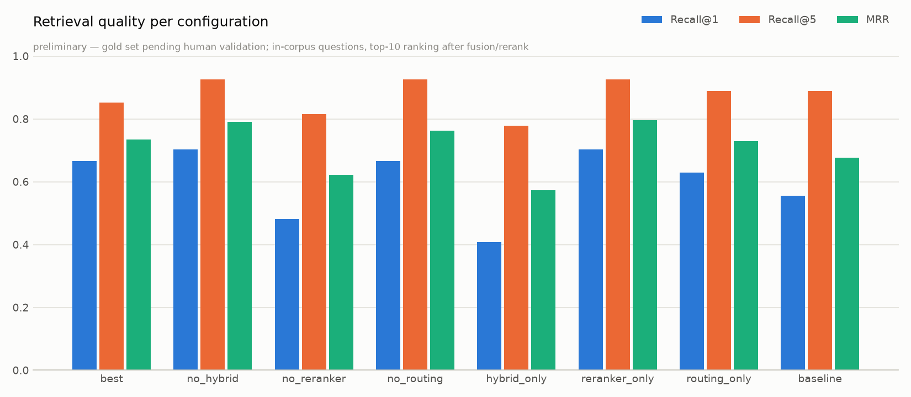
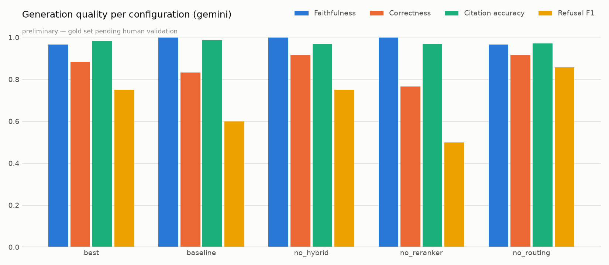

# Evaluation report

> **Status: preliminary — gold set pending human validation.** 30/30 test items are not yet validated by a human (`eval/testset_review.md`). All tables below are preliminary.

## Setup

- Corpus: TS 23.501 V18.12.0 (Rel-18), TS 24.501 V18.14.0 (Rel-18) — see `data/VERSIONS.md`
- Embeddings: `BAAI/bge-m3` · reranker: `BAAI/bge-reranker-v2-m3` · vector DB: Qdrant (cosine) · BM25: bm25s + telecom tokenizer · RRF k = 60
- Retrieval: dense top 50, BM25 top 50, fused top 30, final top-k 6, ≥2 chunks per spec for cross routes
- Test set: 30 questions (20 simple, 7 cross, 3 out-of-corpus); retrieval metrics on the 27 in-corpus questions, top-10 ranking after fusion/rerank; a hit is the gold section or one of its sub-clauses, same spec
- Retrieval run: 2026-11-21 20:51 UTC, commit `49b110c`

Configurations: `best` = hybrid on, reranker on, routing on; `no_hybrid` = hybrid off, reranker on, routing on; `no_reranker` = hybrid on, reranker off, routing on; `no_routing` = hybrid on, reranker on, routing off; `hybrid_only` = hybrid on, reranker off, routing off; `reranker_only` = hybrid off, reranker on, routing off; `routing_only` = hybrid off, reranker off, routing on; `baseline` = hybrid off, reranker off, routing off

## Retrieval

### Retrieval ablation — all in-corpus questions (n=27) — *preliminary — gold set pending human validation*

| Config | Hybrid | Reranker | Routing | R@1 | R@3 | R@5 | R@10 | MRR |
|---|---|---|---|---|---|---|---|---|
| best | ✓ | ✓ | ✓ | 0.667 | 0.778 | 0.852 | 0.926 | 0.734 |
| no_hybrid | ✗ | ✓ | ✓ | 0.704 | 0.852 | 0.926 | 0.963 | 0.790 |
| no_reranker | ✓ | ✗ | ✓ | 0.481 | 0.704 | 0.815 | 0.889 | 0.622 |
| no_routing | ✓ | ✓ | ✗ | 0.667 | 0.852 | 0.926 | 0.963 | 0.762 |
| hybrid_only | ✓ | ✗ | ✗ | 0.407 | 0.667 | 0.778 | 0.889 | 0.574 |
| reranker_only | ✗ | ✓ | ✗ | 0.704 | 0.926 | 0.926 | 0.963 | 0.795 |
| routing_only | ✗ | ✗ | ✓ | 0.630 | 0.852 | 0.889 | 0.926 | 0.730 |
| baseline | ✗ | ✗ | ✗ | 0.556 | 0.815 | 0.889 | 0.926 | 0.677 |

### Per question type (R@5 / MRR) — *preliminary — gold set pending human validation*

| Config | simple-23 R@5 | simple-24 R@5 | cross R@5 | simple-23 MRR | simple-24 MRR | cross MRR | cross both-spec R@5 | cross both-spec R@10 |
|---|---|---|---|---|---|---|---|---|
| best | 1.000 | 1.000 | 0.429 | 0.787 | 0.870 | 0.465 | 0.000 | 0.000 |
| no_hybrid | 1.000 | 1.000 | 0.714 | 0.792 | 0.950 | 0.559 | 0.000 | 0.000 |
| no_reranker | 0.800 | 0.900 | 0.714 | 0.717 | 0.623 | 0.486 | 0.000 | 0.000 |
| no_routing | 1.000 | 1.000 | 0.714 | 0.792 | 0.870 | 0.566 | 0.143 | 0.143 |
| hybrid_only | 0.800 | 0.900 | 0.571 | 0.625 | 0.625 | 0.427 | 0.143 | 0.143 |
| reranker_only | 1.000 | 1.000 | 0.714 | 0.800 | 0.950 | 0.568 | 0.143 | 0.286 |
| routing_only | 0.900 | 1.000 | 0.714 | 0.796 | 0.792 | 0.548 | 0.000 | 0.000 |
| baseline | 0.900 | 1.000 | 0.714 | 0.679 | 0.792 | 0.512 | 0.143 | 0.286 |

### Router accuracy — *preliminary — gold set pending human validation*

| n | route ⊇ gold specs | exact | exact simple-23 | exact simple-24 | exact cross |
|---|---|---|---|---|---|
| 27 | 0.778 | 0.741 | 1.000 | 0.900 | 0.143 |

### Score-gate calibration — *preliminary — gold set pending human validation*

Rule: max refusal TPR with zero false refusals; ties -> middle threshold. Chosen: reranker_threshold = **0.45**, dense_threshold = **0.25** (recorded in `config.yaml`).

| threshold | refusal TPR (out-of-corpus) | false-refusal rate |
|---|---|---|
| 0.0 | 0.000 | 0.000 |
| 0.05 | 0.333 | 0.000 |
| 0.1 | 0.667 | 0.000 |
| 0.15 | 0.667 | 0.000 |
| 0.2 | 0.667 | 0.000 |
| 0.25 | 1.000 | 0.000 |
| 0.3 | 1.000 | 0.000 |
| 0.35 | 1.000 | 0.000 |
| 0.4 | 1.000 | 0.000 |
| 0.45 | 1.000 | 0.000 |
| 0.5 | 1.000 | 0.000 |
| 0.55 | 1.000 | 0.000 |
| 0.6 | 1.000 | 0.000 |

| threshold | refusal TPR (out-of-corpus) | false-refusal rate |
|---|---|---|
| 0.0 | 0.000 | 0.000 |
| 0.05 | 0.000 | 0.000 |
| 0.1 | 0.000 | 0.000 |
| 0.15 | 0.000 | 0.000 |
| 0.2 | 0.000 | 0.000 |
| 0.25 | 0.000 | 0.000 |
| 0.3 | 0.000 | 0.000 |
| 0.35 | 0.000 | 0.000 |
| 0.4 | 0.000 | 0.000 |
| 0.45 | 0.000 | 0.000 |
| 0.5 | 0.000 | 0.000 |
| 0.55 | 0.333 | 0.037 |
| 0.6 | 1.000 | 0.148 |

## Generation

### Generation — provider `gemini` (gemini-3.5-flash-lite) — *preliminary — gold set pending human validation*

| Config | n | Faithfulness | Correctness | Citation acc. | Citation acc. (loose) | Gold cited | Not grounded | Refusal P | Refusal R | Refusal F1 | False refusals | Latency mean (s) | p95 (s) | Fallback |
|---|---|---|---|---|---|---|---|---|---|---|---|---|---|---|
| best | 30/30 | 0.97 | 0.88 | 0.98 | 0.98 | 0.81 | 0.00 | 0.60 | 1.00 | 0.75 | 2 | 2.1 | 3.8 | 0.00 |
| baseline | 30/30 | 1.00 | 0.83 | 0.99 | 0.99 | 0.78 | 0.00 | 0.43 | 1.00 | 0.60 | 4 | 1.9 | 3.3 | 0.00 |
| no_hybrid | 30/30 | 1.00 | 0.92 | 0.97 | 0.97 | 0.93 | 0.00 | 0.60 | 1.00 | 0.75 | 2 | 2.0 | 4.0 | 0.00 |
| no_reranker | 30/30 | 1.00 | 0.77 | 0.97 | 0.97 | 0.67 | 0.00 | 0.33 | 1.00 | 0.50 | 6 | 1.7 | 2.7 | 0.00 |
| no_routing | 30/30 | 0.97 | 0.92 | 0.97 | 0.97 | 0.89 | 0.00 | 0.75 | 1.00 | 0.86 | 1 | 1.8 | 3.4 | 0.00 |

Faithfulness and correctness: LLM judge with a fixed 0 / 0.5 / 1 rubric (`eval/metrics.py`), judge = Gemini. Citation accuracy = valid citations / all citations (strict: exact section among the sources; loose: also ancestors). Gold cited = answer cites ≥1 gold section.

### Real end-to-end latency (CPU laptop, no reranker cache)

| Config | n | LLM | total mean (s) | total max (s) | dense (s) | rerank (s) | LLM (s) |
|---|---|---|---|---|---|---|---|
| best | 5 | gemini-3.5-flash-lite | 48.1 | 60.1 | 2.09 | 43.59 | 2.45 |
| no_reranker | 5 | gemini-3.5-flash-lite | 2.0 | 3.4 | 0.14 | 0.0 | 1.87 |

The latency columns of the generation table above reuse cached reranker scores (`eval/results/raw/rerank_cache.json`) and therefore exclude the cross-encoder compute; this table (`python -m eval.measure_latency`) shows what an app user waits for on CPU.

## Qualitative examples (config `best`)

### Simple question — `s23-01`

**Q:** What is the role of the AMF in the 5G System?

**Answer:**

> The Access and Mobility Management Function (AMF) includes the following functionality (some or all of which may be supported in a single instance of an AMF):
> 
> * Termination of RAN CP interface (N2) [TS 23.501 §6.2.1].
> * Termination of NAS (N1), NAS ciphering and integrity protection [TS 23.501 §6.2.1].
> * Registration management [TS 23.501 §6.2.1].
> * Connection management [TS 23.501 §6.2.1].
> * Reachability management [TS 23.501 §6.2.1].
> * Mobility Management [TS 23.501 §6.2.1].
> * Lawful intercept (for AMF events and interface to LI System) [TS 23.501 §6.2.1].
> * Provide transport for SM messages between UE and SMF [TS 23.501 §6.2.1].
> * Transparent proxy for routing SM messages [TS 23.501 §6.2.1].
> * Access Authentication [TS 23.501 §6.2.1].
> * Access Authorization [TS 23.501 §6.2.1].
> * Provide transport for SMS messages between UE and SMSF [TS 23.501 §6.2.1].
> * Security Anchor Functionality (SEAF) as specified in TS 33.501 [29] [TS 23.501 §6.2.1].
> * Location Services management for regulatory services [TS 23.501 §6.2.1].
> * Provide transport for Location Services messages between UE and LMF as well as between RAN and LMF [TS 23.501 §6.2.1].
> * EPS Bearer ID allocation for interworking with EPS [TS 23.501 §6.2.1].
> * UE mobility event notification [TS 23.501 §6.2.1].
> * S-NSSAIs per TA mapping notification [TS 23.501 §6.2.1].
> * Support for Control Plane CIoT 5GS Optimisation [TS 23.501 §6.2.1].
> * Support for User Plane CIoT 5GS Optimisation [TS 23.501 §6.2.1].
> * Support for restriction of use of Enhanced Coverage [TS 23.501 §6.2.1].
> * Provisioning of external parameters (Expected UE Behaviour parameters or Network Configuration parameters) [TS 23.501 §6.2.1].
> * Support for Network Slice-Specific Authentication and Authorization [TS 23.501 §6.2.1].
> * Support for charging [TS 23.501 §6.2.1].
> * Controlling the 5G access stratum-based time distribution based on UE's subscription data [TS 23.501 §6.2.1].
> * Controlling the gNB's time synchronization status reporting and subscription [TS 23.501 §6.2.1].
> 
> To support non-3GPP access networks, the AMF may also include the following functionality:
> * Support of N2 interface with N3IWF/TNGF (over which some 3GPP access information/procedures may not apply and non-3GPP access specific information may be applied) [TS 23.501 §6.2.1].
> * Support of NAS signalling with a UE over N3IWF/TNGF (where some procedures supported over 3GPP access may not be applicable to untrusted non-3GPP access, e.g., Paging) [TS 23.501 §6.2.1].
> * Support of authentication of UEs connected over N3IWF/TNGF [TS 23.501 §6.2.1].
> * Management of mobility, authentication, and separate security context state(s) of a UE connected via a non-3GPP access or connected via a 3GPP access and a non-3GPP access simultaneously [TS 23.501 §6.2.1].
> * Support for a co-ordinated RM management context valid over a 3GPP access and a Non-3GPP access [TS 23.501 §6.2.1].
> * Support for dedicated CM management contexts for the UE for connectivity over non-3GPP access [TS 23.501 §6.2.1].
> * Determine whether the serving N3IWF/TNGF is appropriate based on the slices supported by the N3IWFs/TNGFs [TS 23.501 §6.2.1].
> 
> Additionally, the AMF allocates a 5G-GUTI to the UE that is common to both 3GPP and non-3GPP access, and may re-assign a new 5G-GUTI to the UE at any time or under conditions specified in TS 33.501 [29] [TS 23.501 §5.9.4]. During the Registration procedure, the AMF retrieves subscription data from the UDM and uses it to control 5G access stratum-based time distribution if received [TS 23.501 §5.27.1.11].

Route: TS 23.501 (architecture / stage 2 signals) · gate score 0.962 · sources: TS 23.501 §5.21.2.1, TS 23.501 §5.9.4, TS 23.501 §5.27.1.11, TS 23.501 §4.2.2, TS 23.501 §6.2.1, TS 23.501 §5.21.2.2.1 · judge: The answer accurately and comprehensively lists the roles and functions of the AMF based on the provided context, supported by correct citations.

### Cross-spec question — `x-04`

**Q:** What is the registration area and how does the periodic registration update timer work?

**Answer:**

> **Registration Area:**
> - For a given serving PLMN, an AMF associates multiple access-specific RM contexts for a UE with a Registration Area per access type (3GPP / Non-3GPP), meaning there is one Registration Area for 3GPP access and another Registration Area for non-3GPP access, which are independent [TS 23.501 §5.3.2.4]. 
> - When the AMF indicates MICO mode to a UE, the registration area is not constrained by paging area size [TS 23.501 §5.4.1.3]. If the AMF serving area is the whole PLMN, based on local policy and subscription information, it may decide to provide an "all PLMN" registration area to the UE, in which case re-registration to the same PLMN due to mobility does not apply [TS 23.501 §5.4.1.3].
> - If a registration area that is not the "all PLMN" registration area is allocated to a UE in MICO mode, the UE determines if it is within the registration area or not when it has Mobile Originated (MO) data or MO signalling, and performs Mobility Registration Update before initiating the MO data or MO signalling if it is not within the registration area [TS 23.501 §5.4.1.3].
> - The AMF provides the Registration Area to the NG-RAN as part of the RRC Inactive Assistance Information [TS 23.501 §5.3.3.2.5].
> 
> **Periodic Registration Update Timer:**
> - Whenever a UE in RM-REGISTERED state enters CM-IDLE state, it starts a periodic registration timer according to the periodic registration timer value received from the AMF during a Registration procedure [TS 23.501 §5.4.1.1].
> - The AMF allocates a periodic registration timer value to the UE based on local policies, subscription information, and information provided by the UE [TS 23.501 §5.4.1.1].
> - After the expiry of the periodic registration timer, the UE shall perform a periodic registration [TS 23.501 §5.4.1.1]. If the UE moves out of network coverage when its periodic registration timer expires, the UE shall perform a Registration procedure when it next returns to the coverage [TS 23.501 §5.4.1.1].
> - The AMF shall not provide a Periodic Registration Timer for the UE over a Non-3GPP access, and consequently, the UE need not perform Periodic Registration Update procedure over Non-3GPP access [TS 23.501 §5.3.2.4].
> - If the UE supports 'Strictly Periodic Registration Timer Indication', it indicates this capability in the Registration Request message [TS 23.501 §5.31.7.5]. If provided by the AMF together with the periodic registration timer value, the UE and AMF start the periodic registration timer after completion of the Registration procedure, neither stop nor restart it when entering CM-CONNECTED state, and keep it running while in CM-CONNECTED and after returning to CM-IDLE [TS 23.501 §5.31.7.5]. 
> - Under 'Strictly Periodic Registration Timer Indication', if and only when the timer expires and the UE is in CM-IDLE, the UE performs a Periodic Registration Update; if it expires while the UE is in CM-CONNECTED, the AMF and UE restart the timer while still applying the indication [TS 23.501 §5.31.7.5].
> - If the periodic registration timer is renegotiated during a Registration procedure (e.g., triggered by UE Configuration Update), the running timer is stopped and restarted using the renegotiated value, even when the Strictly Periodic Registration Timer Indication was provided [TS 23.501 §5.31.7.5].

Route: TS 23.501 (architecture / stage 2 signals) · gate score 0.949 · sources: TS 23.501 §5.4.1.1, TS 23.501 §5.3.2.4, TS 23.501 §5.4.1.3, TS 23.501 §5.3.3.2.5, TS 23.501 §5.31.7.5, TS 23.501 §5.4.2 · judge: The answer is completely faithful to the provided context and accurately covers both the registration area concept and the operation of the periodic registration update timer based on the specifications.

### Out-of-corpus question — `o-01`

**Q:** What is the maximum PHY data rate of Wi-Fi 7 (IEEE 802.11be)?

**Answer:**

> I could not find this information in the documents.

Route: TS 24.501, TS 23.501 (no signal) · gate score 0.202 · sources: none · judge: Both the reference and the answer correctly state that the information is not available in the documents.

## Failure analysis

**Retrieval misses (config `best`, no gold section in top-5): 4**

- `x-01` gold TS 23.501 §5.3.2; TS 24.501 §5.5.1.2 — route TS 23.501, TS 24.501; top-3 retrieved: TS 24.501 §4.4.2.5, TS 24.501 §5.3.1.1, TS 24.501 §4.4.2.5; R@10 = 0.0
- `x-02` gold TS 23.501 §5.6.1; TS 24.501 §6.4.1 — route TS 24.501; top-3 retrieved: TS 24.501 §6.1.1, TS 24.501 §4.2, TS 24.501 §6.2.18; R@10 = 0.0
- `x-04` gold TS 23.501 §5.3.2.3; TS 24.501 §5.3.7, §10.2 — route TS 23.501; top-3 retrieved: TS 23.501 §5.4.1.1, TS 23.501 §5.3.2.4, TS 23.501 §5.4.1.3; R@10 = 1.0
- `x-07` gold TS 23.501 §5.10.1, §6.2.1; TS 24.501 §5.4.1, §5.4.2 — route TS 24.501; top-3 retrieved: TS 24.501 §4.4.2.1.1, TS 24.501 §4.4.2.5, TS 24.501 §4.4.2.5; R@10 = 1.0

**Answers not judged fully correct (config `best`): 5**

- `x-01` correctness 0.5 faithfulness 0.5 — The answer includes an unsupported detail regarding the specific clause details for the integrity check failure response at the end, and misses key steps from the reference regarding the complete registration flow like REGISTRATION ACCEPT and REGISTRATION COMPLETE.
- `x-02` correctness 0.5 faithfulness 1.0 — The answer is faithful to the context but incomplete regarding how a PDU session is generally established and which messages are exchanged, because the provided context lacks those details.
- `x-03` correctness 0.0 faithfulness 1.0 — The answer claims the information is not in the documents, but the reference and context contain the details about how the UE indicates the requested NSSAI during registration. refused
- `x-05` correctness 0.0 faithfulness 1.0 — The assistant falsely claimed the information was not in the provided documents, whereas the context contains relevant procedural details about re-establishing user plane resources using the Service Request procedure (e.g., via Uplink data status IE). refused
- `x-06` correctness 0.5 faithfulness 1.0 — The answer is faithful to the provided context and correctly details the TS 24.501 UE-initiated de-registration procedure, but it misses the TS 23.501 Registration Management (RM) states (RM-REGISTERED and RM-DEREGISTERED) mentioned in the reference.

