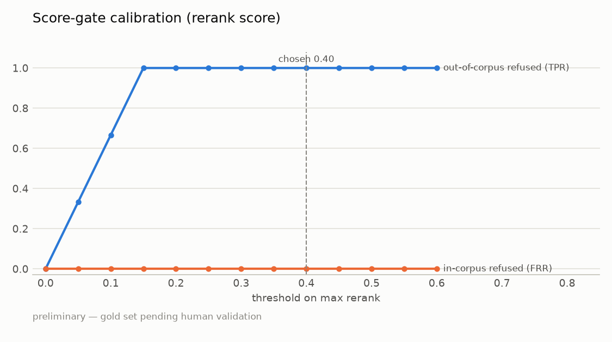

# Evaluation report

> **Status: preliminary — gold set pending human validation.** 30/30 test items are not yet validated by a human (`eval/testset_review.md`). All tables below are preliminary.

## Setup

- Corpus: TS 23.501 V18.12.0 (Rel-18), TS 24.501 V18.14.0 (Rel-18) — see `data/VERSIONS.md`
- Embeddings: `BAAI/bge-m3` · reranker: `BAAI/bge-reranker-v2-m3` · vector DB: Qdrant (cosine) · BM25: bm25s + telecom tokenizer · RRF k = 60
- Retrieval: dense top 50, BM25 top 50, fused top 15, final top-k 6, ≥2 chunks per spec for cross routes
- Test set: 30 questions (20 simple, 7 cross, 3 out-of-corpus); retrieval metrics on the 27 in-corpus questions, top-10 ranking after fusion/rerank; a hit is the gold section or one of its sub-clauses, same spec
- Retrieval run: 2026-11-22 13:02 UTC, commit `c49c352`

Configurations: `best` = hybrid on, reranker on, routing on; `no_hybrid` = hybrid off, reranker on, routing on; `no_reranker` = hybrid on, reranker off, routing on; `no_routing` = hybrid on, reranker on, routing off; `hybrid_only` = hybrid on, reranker off, routing off; `reranker_only` = hybrid off, reranker on, routing off; `routing_only` = hybrid off, reranker off, routing on; `baseline` = hybrid off, reranker off, routing off

## Retrieval

### Retrieval ablation — all in-corpus questions (n=27) — *preliminary — gold set pending human validation*

| Config | Hybrid | Reranker | Routing | R@1 | R@3 | R@5 | R@10 | MRR |
|---|---|---|---|---|---|---|---|---|
| best | ✓ | ✓ | ✓ | 0.741 | 0.889 | 0.889 | 0.926 | 0.807 |
| no_hybrid | ✗ | ✓ | ✓ | 0.741 | 0.889 | 0.889 | 0.926 | 0.807 |
| no_reranker | ✓ | ✗ | ✓ | 0.481 | 0.815 | 0.889 | 0.889 | 0.648 |
| no_routing | ✓ | ✓ | ✗ | 0.667 | 0.889 | 0.889 | 0.926 | 0.770 |
| hybrid_only | ✓ | ✗ | ✗ | 0.481 | 0.778 | 0.852 | 0.889 | 0.627 |
| reranker_only | ✗ | ✓ | ✗ | 0.704 | 0.889 | 0.889 | 0.926 | 0.788 |
| routing_only | ✗ | ✗ | ✓ | 0.630 | 0.852 | 0.889 | 0.926 | 0.730 |
| baseline | ✗ | ✗ | ✗ | 0.556 | 0.815 | 0.889 | 0.926 | 0.677 |

### Per question type (R@5 / MRR) — *preliminary — gold set pending human validation*

| Config | simple-23 R@5 | simple-24 R@5 | cross R@5 | simple-23 MRR | simple-24 MRR | cross MRR | cross both-spec R@5 | cross both-spec R@10 |
|---|---|---|---|---|---|---|---|---|
| best | 1.000 | 1.000 | 0.571 | 0.817 | 0.950 | 0.589 | 0.000 | 0.000 |
| no_hybrid | 1.000 | 1.000 | 0.571 | 0.817 | 0.950 | 0.587 | 0.000 | 0.000 |
| no_reranker | 0.900 | 1.000 | 0.714 | 0.700 | 0.692 | 0.512 | 0.000 | 0.143 |
| no_routing | 0.900 | 1.000 | 0.714 | 0.717 | 0.950 | 0.589 | 0.143 | 0.143 |
| hybrid_only | 0.800 | 1.000 | 0.714 | 0.625 | 0.692 | 0.538 | 0.143 | 0.143 |
| reranker_only | 1.000 | 1.000 | 0.571 | 0.817 | 0.950 | 0.516 | 0.143 | 0.143 |
| routing_only | 0.900 | 1.000 | 0.714 | 0.796 | 0.792 | 0.548 | 0.000 | 0.143 |
| baseline | 0.900 | 1.000 | 0.714 | 0.679 | 0.792 | 0.512 | 0.143 | 0.286 |

### Router accuracy — *preliminary — gold set pending human validation*

| n | route ⊇ gold specs | exact | exact simple-23 | exact simple-24 | exact cross |
|---|---|---|---|---|---|
| 27 | 0.815 | 0.778 | 1.000 | 0.900 | 0.286 |

### Score-gate calibration — *preliminary — gold set pending human validation*

Rule: max refusal TPR with zero false refusals; ties -> middle threshold. Chosen: reranker_threshold = **0.4**, dense_threshold = **0.55** (recorded in `config.yaml`).

| threshold | refusal TPR (out-of-corpus) | false-refusal rate |
|---|---|---|
| 0.0 | 0.000 | 0.000 |
| 0.05 | 0.333 | 0.000 |
| 0.1 | 0.667 | 0.000 |
| 0.15 | 1.000 | 0.000 |
| 0.2 | 1.000 | 0.000 |
| 0.25 | 1.000 | 0.000 |
| 0.3 | 1.000 | 0.000 |
| 0.35 | 1.000 | 0.000 |
| 0.4 | 1.000 | 0.000 |
| 0.45 | 1.000 | 0.000 |
| 0.5 | 1.000 | 0.000 |
| 0.55 | 1.000 | 0.000 |
| 0.6 | 1.000 | 0.000 |

| threshold | refusal TPR (out-of-corpus) | false-refusal rate |
|---|---|---|
| 0.0 | 0.000 | 0.000 |
| 0.05 | 0.000 | 0.000 |
| 0.1 | 0.000 | 0.000 |
| 0.15 | 0.000 | 0.000 |
| 0.2 | 0.000 | 0.000 |
| 0.25 | 0.000 | 0.000 |
| 0.3 | 0.000 | 0.000 |
| 0.35 | 0.000 | 0.000 |
| 0.4 | 0.000 | 0.000 |
| 0.45 | 0.000 | 0.000 |
| 0.5 | 0.000 | 0.000 |
| 0.55 | 0.333 | 0.000 |
| 0.6 | 1.000 | 0.111 |

## Generation

### Generation — previous round (bge-reranker-base, 15 candidates, 512 tokens, gate 0.10, hard routing, BM25 weight 1.0, prompt v1) — provider `gemini` (gemini-3.5-flash-lite) — *preliminary — gold set pending human validation*

> Run stopped early (quota): judge no_hybrid/o-02: All LLM providers failed:. Rows with n < n_expected are partial; re-run the same command to resume.

| Config | n | Faithfulness | Correctness | Citation acc. | Citation acc. (loose) | Gold cited | Not grounded | Refusal P | Refusal R | Refusal F1 | False refusals | Latency mean (s) | p95 (s) | Fallback |
|---|---|---|---|---|---|---|---|---|---|---|---|---|---|---|
| best | 30/30 | 1.00 | 0.80 | 0.97 | 0.97 | 0.74 | 0.00 | 0.33 | 1.00 | 0.50 | 6 | 4.0 | 6.7 | 0.00 |
| baseline | 30/30 | 1.00 | 0.82 | 0.99 | 0.99 | 0.78 | 0.00 | 0.38 | 1.00 | 0.55 | 5 | 4.0 | 8.1 | 0.00 |
| no_hybrid | 30/30 | 1.00 | 0.83 | 1.00 | 1.00 | 0.74 | 0.00 | 0.43 | 1.00 | 0.60 | 4 | 3.1 | 6.0 | 0.00 |

Faithfulness and correctness: LLM judge with a fixed 0 / 0.5 / 1 rubric (`eval/metrics.py`), judge = Gemini — **the same model that generated the answers**, so these two columns may carry self-preference bias; see the cross-judging section for the check. Citation accuracy = valid citations / all citations (strict: exact section among the sources; loose: also ancestors). Gold cited = answer cites ≥1 gold section.

### Generation — first round (router v1, bge-reranker-v2-m3, 30 candidates, 1024 tokens, prompt v1) — provider `gemini` (gemini-3.5-flash-lite) — *preliminary — gold set pending human validation*

| Config | n | Faithfulness | Correctness | Citation acc. | Citation acc. (loose) | Gold cited | Not grounded | Refusal P | Refusal R | Refusal F1 | False refusals | Latency mean (s) | p95 (s) | Fallback |
|---|---|---|---|---|---|---|---|---|---|---|---|---|---|---|
| best | 30/30 | 0.97 | 0.88 | 0.98 | 0.98 | 0.81 | 0.00 | 0.60 | 1.00 | 0.75 | 2 | 2.1 | 3.8 | 0.00 |
| baseline | 30/30 | 1.00 | 0.83 | 0.99 | 0.99 | 0.78 | 0.00 | 0.43 | 1.00 | 0.60 | 4 | 1.9 | 3.3 | 0.00 |
| no_hybrid | 30/30 | 1.00 | 0.92 | 0.97 | 0.97 | 0.93 | 0.00 | 0.60 | 1.00 | 0.75 | 2 | 2.0 | 4.0 | 0.00 |
| no_reranker | 30/30 | 1.00 | 0.77 | 0.97 | 0.97 | 0.67 | 0.00 | 0.33 | 1.00 | 0.50 | 6 | 1.7 | 2.7 | 0.00 |
| no_routing | 30/30 | 0.97 | 0.92 | 0.97 | 0.97 | 0.89 | 0.00 | 0.75 | 1.00 | 0.86 | 1 | 1.8 | 3.4 | 0.00 |

Faithfulness and correctness: LLM judge with a fixed 0 / 0.5 / 1 rubric (`eval/metrics.py`), judge = Gemini — **the same model that generated the answers**, so these two columns may carry self-preference bias; see the cross-judging section for the check. Citation accuracy = valid citations / all citations (strict: exact section among the sources; loose: also ancestors). Gold cited = answer cites ≥1 gold section.

_Generation evaluation not run yet._

### Real end-to-end latency (CPU laptop, no reranker cache)

| Config | Reranker | n | LLM | total mean (s) | total max (s) | dense (s) | rerank (s) | LLM (s) |
|---|---|---|---|---|---|---|---|---|
| best | – | 5 | gemini-3.1-flash-lite | 7.6 | 8.5 | 0.15 | 4.14 | 3.28 |
| no_reranker | – | 5 | gemini-3.1-flash-lite | 3.0 | 4.2 | 0.15 | 0.0 | 2.83 |

The latency columns of the generation table above reuse cached reranker scores (`eval/results/raw/rerank_cache.json`) and therefore exclude the cross-encoder compute; this table (`python -m eval.measure_latency`) shows what an app user waits for on CPU.

## Cross-judging: self-preference check

The main generation tables are judged by the same model that wrote the answers (gemini-3.5-flash-lite judges gemini-3.5-flash-lite). As a check, the `best` answers of two models are each judged by both judges, on frozen answer sets (`eval/results/raw/crossjudge/`) with the same rubric. Both answer sets were produced with router v1 (the router at the time of the original run).

**Faithfulness**

| Answers \ Judge | gemini judge (gemini-3.5-flash-lite) | groq judge (openai/gpt-oss-120b) |
|---|---|---|
| gemini answers (gemini-3.5-flash-lite) | 1.00 (n=9) | 1.00 (n=9) |
| groq answers (openai/gpt-oss-120b) | 1.00 (n=9) | 0.94 (n=9) |

**Correctness**

| Answers \ Judge | gemini judge (gemini-3.5-flash-lite) | groq judge (openai/gpt-oss-120b) |
|---|---|---|
| gemini answers (gemini-3.5-flash-lite) | 1.00 (n=9) | 0.94 (n=9) |
| groq answers (openai/gpt-oss-120b) | 1.00 (n=9) | 0.94 (n=9) |

Metrics that need no judge (same frozen answers):

| Answers | Citation acc. | Gold cited | Refusal P | Refusal R | Refusal F1 | False refusals |
|---|---|---|---|---|---|---|
| gemini (gemini-3.5-flash-lite) | 0.98 | 0.81 | 0.60 | 1.00 | 0.75 | 2 |
| groq (openai/gpt-oss-120b) | 0.98 | 0.67 | 0.75 | 1.00 | 0.86 | 1 |

**Self-preference.** faithfulness: on average a judge scores its own model's answers -0.03 higher than the other judge does (Gemini judge on Gemini answers +0.00, Groq judge on Groq answers -0.06); correctness: on average a judge scores its own model's answers +0.00 higher than the other judge does (Gemini judge on Gemini answers +0.06, Groq judge on Groq answers -0.06). A positive value is a self-preference bias of that size; with 30 questions, a few hundredths is one or two answers, so only a gap that both judges agree on (same ranking of the two answer sets) should be trusted.

## Reranker speed / quality benchmark (CPU)

MRR / recall of the `best` configuration on the in-corpus questions for each number of fused candidates sent to the reranker (`retrieval.fused_top_n`) and truncation length (`reranker.max_length`). Latency = reranking time per answer, measured without cache on a fixed sample of questions; retrieval = reranking + routing / dense / BM25. The LLM adds ≈ 2 s (see the latency table).

| Reranker | fused_top_n | max_length | MRR | R@5 | R@10 | rerank s/answer | max s | retrieval s/answer |
|---|---|---|---|---|---|---|---|---|
| bge-reranker-v2-m3 | 15 | 512 | 0.754 | 0.852 | 0.852 | 12.8 | 13.0 | 13.0 |
| bge-reranker-v2-m3 | 20 | 512 | 0.744 | 0.852 | 0.926 | 16.6 | 17.5 | 16.8 |
| bge-reranker-v2-m3 | 30 | 512 | 0.732 | 0.852 | 0.889 | 26.0 | 26.6 | 26.2 |
| bge-reranker-v2-m3 | 15 | 1024 | 0.753 | 0.852 | 0.889 | 23.4 | 24.5 | 23.6 |
| bge-reranker-v2-m3 | 20 | 1024 | 0.756 | 0.852 | 0.926 | 27.9 | 30.6 | 28.0 |
| bge-reranker-v2-m3 | 30 | 1024 | 0.734 | 0.852 | 0.926 | 43.8 | 46.1 | 43.9 |
| bge-reranker-base | 15 | 512 | 0.747 | 0.815 | 0.852 | 3.9 | 4.0 | 4.0 |
| bge-reranker-base | 20 | 512 | 0.746 | 0.852 | 0.889 | 4.9 | 5.3 | 5.0 |
| bge-reranker-base | 30 | 512 | 0.727 | 0.852 | 0.852 | 7.6 | 8.1 | 7.8 |

**Chosen default:** BAAI/bge-reranker-base with fused_top_n=15, max_length=512: MRR 0.747 vs 0.734 for the previous default (bge-reranker-v2-m3, 30, 1024); reranking 3.9 s instead of 43.8 s per answer on this CPU. Rule: fastest setting whose MRR stays within 0.02 of the previous default. Trade-offs: recall@5 0.815 vs 0.852 (one question); bge-reranker-base is English/Chinese, not multilingual (the French bonus used bge-reranker-v2-m3).

## Router: before / after

Router v2 adds three general rules (architecture AND NAS signals → both specs; "procedure … messages" phrasing → both specs; more verbs that ask what a network function does). It was tuned **only** on `tests/test_router.py` (12 new cross-spec questions written independently of the test set, plus single-spec guards); the evaluation set was not used for tuning. Both columns use the same retrieval settings (bge-reranker-base, 15 candidates, 512 tokens, hard routing, BM25 weight 1.0); only `retrieval.router_version` differs.

| Router accuracy (config best) | v1 | v2 |
|---|---|---|
| route ⊇ gold specs | 0.778 | 0.815 |
| exact route | 0.741 | 0.778 |
| exact, simple 23.501 | 1.000 | 1.000 |
| exact, simple 24.501 | 0.900 | 0.900 |
| exact, cross-spec | 0.143 | 0.286 |

| Config | Metric | v1 | v2 |
|---|---|---|---|
| `best` | cross recall@5 | 0.429 | 0.429 |
| `best` | cross both_recall@5 | 0.000 | 0.000 |
| `best` | cross mrr | 0.446 | 0.446 |
| `best` | all recall@5 | 0.815 | 0.815 |
| `best` | all mrr | 0.747 | 0.747 |

## Soft routing and BM25 weight (retrieval only)

`retrieval.routing_mode: hard` filters dense and BM25 search to the routed spec(s); `soft` searches both specs and multiplies the RRF score of the routed spec's chunks by `retrieval.soft_routing_weight` (1.5). When the router picks both specs the two modes are identical. `retrieval.bm25_weight` weights the BM25 list in RRF (the dense list keeps weight 1). With the reranker on, both settings only change *which* 15 candidates reach the cross-encoder; the final order is the reranker's. All runs: 15 candidates, 512 tokens, router v2. `no_hybrid` does not use BM25, so its rows depend on the routing mode only.

| Reranker | Routing | BM25 w | Config | R@1 | R@5 | MRR | cross R@5 | cross both-spec R@5 | cross MRR |
|---|---|---|---|---|---|---|---|---|---|
| bge-reranker-v2-m3 | hard | 1.0 | `best` | 0.704 | 0.852 | 0.754 | 0.571 | 0.000 | 0.457 |
| bge-reranker-v2-m3 | hard | – | `no_hybrid` | 0.704 | 0.852 | 0.776 | 0.429 | 0.000 | 0.468 |
| bge-reranker-v2-m3 | hard | 0.5 | `best` | 0.704 | 0.852 | 0.770 | 0.429 | 0.000 | 0.459 |
| bge-reranker-v2-m3 | hard | 0.25 | `best` | 0.704 | 0.852 | 0.768 | 0.429 | 0.000 | 0.462 |
| bge-reranker-v2-m3 | soft | 1.0 | `best` | 0.667 | 0.889 | 0.750 | 0.714 | 0.000 | 0.607 |
| bge-reranker-v2-m3 | soft | – | `no_hybrid` | 0.741 | 0.889 | 0.807 | 0.571 | 0.000 | 0.587 |
| bge-reranker-v2-m3 | soft | 0.5 | `best` | 0.741 | 0.889 | 0.807 | 0.571 | 0.000 | 0.589 |
| bge-reranker-v2-m3 | soft | 0.25 | `best` | 0.741 | 0.889 | 0.801 | 0.571 | 0.000 | 0.589 |
| bge-reranker-base | hard | 1.0 | `best` | 0.704 | 0.815 | 0.747 | 0.429 | 0.000 | 0.446 |
| bge-reranker-base | hard | – | `no_hybrid` | 0.778 | 0.852 | 0.817 | 0.429 | 0.000 | 0.462 |
| bge-reranker-base | hard | 0.5 | `best` | 0.704 | 0.852 | 0.764 | 0.429 | 0.000 | 0.443 |
| bge-reranker-base | hard | 0.25 | `best` | 0.741 | 0.852 | 0.782 | 0.429 | 0.000 | 0.457 |
| bge-reranker-base | soft | 1.0 | `best` | 0.667 | 0.852 | 0.747 | 0.571 | 0.000 | 0.518 |
| bge-reranker-base | soft | – | `no_hybrid` | 0.778 | 0.889 | 0.831 | 0.571 | 0.000 | 0.516 |
| bge-reranker-base | soft | 0.5 | `best` | 0.704 | 0.889 | 0.783 | 0.571 | 0.000 | 0.514 |
| bge-reranker-base | soft | 0.25 | `best` | 0.704 | 0.889 | 0.779 | 0.571 | 0.000 | 0.516 |

Paired bootstrap on the MRR of `best` (10,000 resamples, seed 42):

| Reranker | Comparison | Questions | n | Δ MRR | 95% CI | Verdict |
|---|---|---|---|---|---|---|
| bge-reranker-v2-m3 | soft − hard, BM25 w 0.5 | all | 27 | +0.037 | [+0.000, +0.106] | within noise |
| bge-reranker-v2-m3 | soft − hard, BM25 w 0.5 | cross | 7 | +0.131 | [+0.000, +0.385] | within noise |
| bge-reranker-v2-m3 | BM25 w 0.5 − 1.0, soft | all | 27 | +0.057 | [-0.005, +0.150] | within noise |
| bge-reranker-v2-m3 | BM25 w 0.5 − 1.0, soft | cross | 7 | -0.018 | [-0.054, +0.000] | within noise |
| bge-reranker-v2-m3 | chosen − previous settings | all | 27 | +0.053 | [-0.003, +0.142] | within noise |
| bge-reranker-v2-m3 | chosen − previous settings | cross | 7 | +0.132 | [-0.032, +0.429] | within noise |
| bge-reranker-base | soft − hard, BM25 w 0.5 | all | 27 | +0.019 | [-0.037, +0.078] | within noise |
| bge-reranker-base | soft − hard, BM25 w 0.5 | cross | 7 | +0.071 | [+0.000, +0.186] | within noise |

### Final retrieval defaults and why

Selection rule (fixed before looking at generation): highest retrieval MRR of `best` with the default reranker (bge-reranker-v2-m3), ties broken in favour of the simpler or the required component.

- **Routing mode: soft.** MRR 0.807 vs 0.770 for hard routing at the same BM25 weight. The gain comes from cross-spec questions the router sends to one spec: soft routing still lets chunks of the other spec into the 15 candidates (cross MRR 0.589 vs 0.459). Simple questions are unchanged or slightly better, because the 1.5× boost keeps the routed spec on top.
- **BM25 weight: 0.5.** 0.807 vs 0.750 (1.0) and 0.801 (0.25). At full weight BM25 pushes keyword-matching but off-topic chunks into the reranker's candidate list; at 0.25 it barely contributes.
- **Hybrid: on.** With these settings `no_hybrid` ties exactly (MRR 0.807, cross MRR 0.587 vs 0.589). The tie is broken in favour of hybrid search: it is a required component of the assignment and BM25 is the component that matches exact identifiers (timers, cause numbers, section numbers) when the dense model misses them.

None of these differences is statistically established on 27 questions (table above), so the choice is a defensible default, not a proven optimum. With bge-reranker-base the ranking differs (`no_hybrid` is best at 0.831), which is one more reason to read the numbers as configuration-specific.

## Statistical caution

Only **n = 27** in-corpus questions are scored, so one question moves recall@k by **0.037** and a difference of a few hundredths is a single question. The table gives the paired difference of per-question scores between two configurations that differ by one component, with a 95% paired-bootstrap interval (10,000 resamples, seed 42). A difference is called *robust* only when the interval excludes 0; otherwise it is within noise for this test set.

| Component | Comparison | Metric | Δ | 95% CI | Verdict |
|---|---|---|---|---|---|
| reranker (all else on) | `best` − `no_reranker` | mrr | +0.159 | [+0.060, +0.262] | robust |
| reranker (all else on) | `best` − `no_reranker` | recall@5 | +0.000 | [-0.111, +0.111] | within noise |
| reranker (dense only) | `reranker_only` − `baseline` | mrr | +0.111 | [+0.004, +0.222] | robust |
| reranker (dense only) | `reranker_only` − `baseline` | recall@5 | +0.000 | [-0.111, +0.111] | within noise |
| BM25 fusion (with reranker) | `best` − `no_hybrid` | mrr | +0.001 | [+0.000, +0.002] | within noise |
| BM25 fusion (with reranker) | `best` − `no_hybrid` | recall@5 | +0.000 | [+0.000, +0.000] | within noise |
| BM25 fusion (no reranker) | `hybrid_only` − `baseline` | mrr | -0.050 | [-0.171, +0.072] | within noise |
| BM25 fusion (no reranker) | `hybrid_only` − `baseline` | recall@5 | -0.037 | [-0.111, +0.000] | within noise |
| routing (with reranker) | `best` − `no_routing` | mrr | +0.037 | [-0.037, +0.130] | within noise |
| routing (with reranker) | `best` − `no_routing` | recall@5 | +0.000 | [-0.111, +0.111] | within noise |
| routing (no reranker) | `routing_only` − `baseline` | mrr | +0.052 | [+0.000, +0.120] | within noise |
| routing (no reranker) | `routing_only` − `baseline` | recall@5 | +0.000 | [+0.000, +0.000] | within noise |

Robust effects on this set: reranker (all else on), reranker (dense only). Every other difference in the ablation tables, including hybrid vs no-hybrid, should be read as *not established* until a larger, validated test set confirms it.

## Qualitative examples (config `best`)

### Simple question — `s23-01`

**Q:** What is the role of the AMF in the 5G System?

**Answer:**

> The Access and Mobility Management Function (AMF) includes the following functionality in the 5G System, and some or all of these may be supported in a single instance of an AMF [TS 23.501 §6.2.1]:
> 
> * Termination of RAN CP interface (N2) [TS 23.501 §6.2.1].
> * Termination of NAS (N1), NAS ciphering and integrity protection [TS 23.501 §6.2.1].
> * Registration management [TS 23.501 §6.2.1].
> * Connection management [TS 23.501 §6.2.1].
> * Reachability management [TS 23.501 §6.2.1].
> * Mobility Management [TS 23.501 §6.2.1].
> * Lawful intercept (for AMF events and interface to LI System) [TS 23.501 §6.2.1].
> * Provide transport for SM messages between UE and SMF [TS 23.501 §6.2.1].
> * Transparent proxy for routing SM messages [TS 23.501 §6.2.1].
> * Access Authentication [TS 23.501 §6.2.1].
> * Access Authorization [TS 23.501 §6.2.1].
> * Provide transport for SMS messages between UE and SMSF [TS 23.501 §6.2.1].
> * Security Anchor Functionality (SEAF) as specified in TS 33.501 [29] [TS 23.501 §6.2.1].
> * Location Services management for regulatory services [TS 23.501 §6.2.1].
> * Provide transport for Location Services messages between UE and LMF as well as between RAN and LMF [TS 23.501 §6.2.1].
> * EPS Bearer ID allocation for interworking with EPS [TS 23.501 §6.2.1].
> * UE mobility event notification [TS 23.501 §6.2.1].
> * S-NSSAIs per TA mapping notification [TS 23.501 §6.2.1].
> * Support for Control Plane CIoT 5GS Optimisation [TS 23.501 §6.2.1].
> * Support for User Plane CIoT 5GS Optimisation [TS 23.501 §6.2.1].
> * Support for restriction of use of Enhanced Coverage [TS 23.501 §6.2.1].
> * Provisioning of external parameters (Expected UE Behaviour parameters or Network Configuration parameters) [TS 23.501 §6.2.1].
> * Support for Network Slice-Specific Authentication and Authorization [TS 23.501 §6.2.1].
> * Support for charging [TS 23.501 §6.2.1].
> * Controlling the 5G access stratum-based time distribution based on UE's subscription data [TS 23.501 §6.2.1].
> * Controlling the gNB's time synchronization status reporting and subscription [TS 23.501 §6.2.1].
> 
> To support non-3GPP access networks, the AMF may also include [TS 23.501 §6.2.1]:
> * Support of N2 interface with N3IWF/TNGF [TS 23.501 §6.2.1].
> * Support of NAS signalling with a UE over N3IWF/TNGF [TS 23.501 §6.2.1].
> * Support of authentication of UEs connected over N3IWF/TNGF [TS 23.501 §6.2.1].
> * Management of mobility, authentication and separate security context state(s) of a UE connected via a non-3GPP access or connected via a 3GPP access and a non-3GPP access simultaneously [TS 23.501 §6.2.1].
> * Support for a co-ordinated RM management context valid over a 3GPP access and a Non 3GPP access [TS 23.501 §6.2.1].
> * Support for dedicated CM management contexts for the UE for connectivity over non-3GPP access [TS 23.501 §6.2.1].
> * Determine whether the serving N3IWF/TNGF is appropriate based on the slices supported by the N3IWFs/TNGFs [TS 23.501 §6.2.1].

Route: TS 23.501 (architecture / stage 2 signals) · gate score 0.952 · sources: TS 23.501 §5.21.2.1, TS 23.501 §4.2.2, TS 23.501 §6.2.1, TS 23.501 §5.19.5.2, TS 23.501 §5.20, TS 23.501 §5.19.3 · judge: The answer accurately and completely lists the role and functionalities of the AMF based directly on the provided context.

### Cross-spec question — `x-05`

**Q:** How are user plane resources of existing PDU sessions re-activated with the service request procedure?

**Answer:**

> To re-activate user plane resources of existing PDU sessions using the service request procedure, the following principles and actions apply according to the documents:
> 
> * The UE includes the Uplink data status IE in the SERVICE REQUEST message [TS 24.501 §5.6.1.4.1].
> * If the UE is not in NB-N1 mode, or if the UE is in NB-N1 mode and does not indicate a request to have user-plane resources established for a number of PDU sessions that exceeds the UE's maximum number of supported user-plane resources, the AMF shall indicate the SMF to re-establish the user-plane resources for the corresponding PDU sessions [TS 24.501 §5.6.1.4.1].
> * The AMF includes the PDU session reactivation result IE in the SERVICE ACCEPT message to indicate the user-plane resources re-establishment result of the PDU sessions for which the UE requested to re-establish the user-plane resources [TS 24.501 §5.6.1.4.1].
> * For a PDU session for LADN, the AMF determines the UE presence in LADN service area and forwards the UE presence in LADN service area towards the SMF [TS 24.501 §5.6.1.4.1].
> * If the Allowed PDU session status IE is included in the SERVICE REQUEST message, the AMF notifies the SMF whether reactivation of user-plane resources for corresponding PDU session(s) associated with non-3GPP access can be performed or cannot be performed based on whether the corresponding PDU session IDs are indicated in the Allowed PDU session status IE (and whether supported user-plane resource limits are respected for UEs in NB-N1 mode) [TS 24.501 §5.6.1.4.1].
> * If user-plane resources are successfully reactivated for a PDU session indicated by the UE in the Allowed PDU session status IE as allowed to be re-established over 3GPP access, the UE considers the corresponding PDU session to be associated with the 3GPP access, and the AMF and SMF update the associated access type [TS 24.501 §5.6.1.4.1].
> * If user-plane resources cannot be established for a PDU session, the AMF includes the PDU session reactivation result IE in the SERVICE ACCEPT message indicating that they cannot be re-established, along with a PDU session reactivation result error cause IE with a specific 5GMM cause (e.g., #43 "LADN not available", #28 "restricted service area", #92 "insufficient user-plane resources for the PDU session", or #69 "insufficient resources for specific slice") depending on the reason provided by the SMF or determined by the AMF [TS 24.501 §5.6.1.4.1].

Route: TS 24.501 (NAS / stage 3 signals) · gate score 0.995 · sources: TS 24.501 §5.6.1.4.2, TS 24.501 §5.6.1.4.1, TS 24.501 §5.6.1.4.2, TS 24.501 §5.5.1.3.4, TS 24.501 §5.6.3.3, TS 24.501 §5.6.1.1 · judge: The answer accurately explains how user plane resources of existing PDU sessions are re-activated using the service request procedure, fully supported by the provided context and consistent with the reference.

### Out-of-corpus question — `o-01`

**Q:** What is the maximum PHY data rate of Wi-Fi 7 (IEEE 802.11be)?

**Answer:**

> I could not find this information in the documents.

Route: TS 24.501, TS 23.501 (no signal) · gate score 0.050 · sources: none · judge: Both the answer and reference correctly state that the information is not present in the provided context.

## Failure analysis

**Retrieval misses (config `best`, no gold section in top-5): 3**

- `x-01` gold TS 23.501 §5.3.2; TS 24.501 §5.5.1.2 — route TS 23.501, TS 24.501; top-3 retrieved: TS 24.501 §4.4.2.5, TS 24.501 §5.3.1.1, TS 24.501 §4.4.2.5; R@10 = 0.0
- `x-02` gold TS 23.501 §5.6.1; TS 24.501 §6.4.1 — route TS 24.501; top-3 retrieved: TS 24.501 §6.1.1, TS 24.501 §6.2.18, TS 24.501 §6.2.3; R@10 = 0.0
- `x-07` gold TS 23.501 §5.10.1, §6.2.1; TS 24.501 §5.4.1, §5.4.2 — route TS 24.501; top-3 retrieved: TS 24.501 §4.4.2.5, TS 24.501 §4.4.2.5, TS 24.501 §4.4.2.5; R@10 = 1.0

**Answers not judged fully correct (config `best`): 5**

- `s23-07` correctness 0.0 faithfulness 1.0 — The answer refuses to answer because the information is missing from the context, but the reference contains the answer, making correctness 0. refused
- `x-01` correctness 0.0 faithfulness 1.0 — The reference answer provides details on the registration procedure and NAS messages (such as REGISTRATION REQUEST, REGISTRATION ACCEPT, and REGISTRATION COMPLETE), but the assistant incorrectly refused to answer despite relevant information being available in the context/specs. refused
- `x-02` correctness 0.0 faithfulness 1.0 — The answer refuses to answer, but the reference contains the information, and parts of the context and standard knowledge base allow for a partial or full answer. refused
- `x-03` correctness 0.0 faithfulness 1.0 — The model refused to answer even though the context contains partial information about how the UE indicates the Requested NSSAI in registration messages, although details about the exact IE encoding come from the reference. refused
- `x-04` correctness 0.0 faithfulness 1.0 — The reference answer provides a detailed explanation of the registration area and periodic registration update timer based on TS 23.501 and TS 24.501, whereas the assistant incorrectly refused to answer. refused

